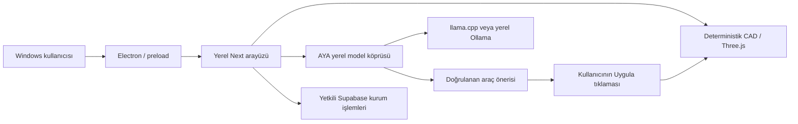

# DentAYA — bütün teknik bilgiler ve geliştirme durumu

**Belge tarihi:** 29 Ekim 2026, Europe/Istanbul.
**İncelenen sabit kaynak:** `2d9d0d74cfbfb26b7808026d6f386d6e053355ed`.
**Ürün kodunun son değişikliği:** `a8e34b4e3eb5614e7120b03051fb14bd005ae467`.
**Sürüm:** `1.0.0-rc.62` geliştirme kopyası; AYA Core `0.18.0`.

Bu dosya, DentAYA'nın ürün kararlarını, gerçek mimarisini, kaynak haritasını, masaüstü ve backend sözleşmelerini, yerel model akışını, çalışma belleğini, CAD motorlarını, kurulum/paketlemeyi, test kanıtlarını ve kalan işleri tek yerde toplar. Yeni bir geliştirici veya ChatGPT, önceki sohbet olmadan durumu anlayabilsin diye hazırlanmıştır.

**Kesin durum:** RC62 final yayımlanmadı. Son kaynak için kullanıcıya sunulacak yeni Windows EXE'si yok. Ana üründe Qwen3 1.7B vardır; deneysel Qwen3.5 4B kabul edilip ürüne alınmadı. Son gerçek model denemesi başarısızdır. Bu belgeyi hazırlarken uygulama kodu değiştirilmedi veya yeni native/Windows testi yapılmış sayılmadı. Kaynak bütünlüğü 29 Ekim'de yeniden kontrol edildi: **2865 dosya PASS**. Test tarihleri ve kapsamları aşağıda ayrıca verilir.

Belgeyi düz metin/Markdown olarak okuyabilir veya ChatGPT'ye yükleyebilirsiniz. `.txt` kopyası aynı UTF-8 içeriği taşır. Belge kaynağın tamamını, model ağırlıklarını, kurucuyu, kişisel ayarları veya hasta dosyalarını içermez. Kaynak/kanıt paketi aşağıdaki ayrı kalıcı bağlantıdadır.

## İçindekiler

1. [Kaynak kimliği, gerçek durum ve arşiv](#bolum-1)
2. [Ürün kararları, sayılar ve çalışma kökleri](#bolum-2)
3. [Platform, modüller, backend, güvenlik ve Windows](#bolum-3)
4. [AYA: model, bellek, IPC, RAG ve kabul](#bolum-4)
5. [CAD: geometri, yerleşim, araçlar ve kalıcılık](#bolum-5)
6. [RC62'ye gerçekten alınmış değişiklikler](#bolum-6)
7. [Test sonuçları ve kanıt kapsamı](#bolum-7)
8. [Kaynak dosyalarının görev haritası](#bolum-8)
9. [Açık işler, kök hata ve tamamlama koşulları](#bolum-9)
10. [Geliştirmeyi devralma ve ortam kuralları](#bolum-10)
11. [Bütün npm komutları, sayfalar, API ve SQL dizinleri](#bolum-11)
12. [Makine tarafından okunabilir durum ve kanıt kayıtları](#bolum-12)
13. [Geçmiş kararların kısa sürüm haritası](#bolum-13)

<a id="bolum-1"></a>

## 1. Kaynak kimliği, gerçek durum ve arşiv

| Konu | Kesin değer |
|---|---|
| Masaüstü deposu | https://github.com/hzsams/dentaya-rc47.git |
| Geliştirme dalı | `professional-workflow` |
| Bu belgenin esas aldığı commit | `2d9d0d74cfbfb26b7808026d6f386d6e053355ed` |
| Değişmeyen kaynak/devir etiketi | `devir-2026-10-28-rc62-wip` |
| Son main tabanı | RC61, `4b6a36047410eeae1ba5057b6a7a69604f662909` |
| Çalışma sürümü | RC62 WIP; paket adı `dentaya-production-rc` |
| Ana ürün son runtime kodu | `a8e34b4e3eb5614e7120b03051fb14bd005ae467` |
| Genel kaynak doğrulaması | PASS; 28 Ekim'de `npm run verify`, 117,688 saniye |
| Son kaynak için final Windows kurucu | Üretilmedi/yayımlanmadı |
| Eski gerçek Windows ön kontrolü | PASS, `61ee568...`; son CAD kodunu içermez |
| Ana managed model | Qwen3 1.7B Q8_0 |
| Yeni model adayı | Unsloth Qwen3.5 4B Q4_K_M; deneysel, kabul edilmedi |
| Son grounding deneyi | 9 gerçek istek, 8 kabul edilen köprü yanıtı, FAIL |
| Canlı kurum/klinik/üretim kabulü | Yapılmadı |

Kaynak ve önceki devir belgeleri:

- [Tam kaynak/devir ZIP'i](https://github.com/hzsams/dentaya-rc47/archive/refs/tags/devir-2026-10-28-rc62-wip.zip)
- [Sabit kaynak ağacı](https://github.com/hzsams/dentaya-rc47/tree/devir-2026-10-28-rc62-wip)
- [Önceki kapsamlı devir](https://github.com/hzsams/dentaya-rc47/blob/devir-2026-10-28-rc62-wip/YENI_CHATGPT_ICIN_TAM_DEVIR.md)
- [Makine durum kaydı](https://github.com/hzsams/dentaya-rc47/blob/devir-2026-10-28-rc62-wip/DEVIR_DURUMU.json)

Kaynak ZIP'i **189551121 bayt**, SHA-256:

```text
1390315d00fd630fb2baa9291460a718a143f6527171a12c922858bd0b810ef4
```

Bu hash 28 Ekim'de gerçekten indirilen arşiv içindir. ZIP CRC'leri ve manifestteki 2865 dosyanın boyut/SHA değerleri doğrulandı; dosya kümesi manifest + manifestin kendisiyle eşleşti. Bu bir kaynak bütünlüğü kanıtıdır; modelin doğru cevap verdiği veya uygulamanın klinik üretim onayı aldığı anlamına gelmez.

Kaynağın `.git`, `node_modules`, `.next`, kişisel `.env`, GGUF ağırlıkları, derlenmiş EXE/DLL ve hasta dosyaları arşivde yoktur. GitHub ZIP'inin dış klasör adı değişebilir; `package.json`, `electron`, `src` ve `AGENTS.md` içeren klasör çalışma köküdür. Bu teknik belge paketi yalnız dokümantasyondur; kaynak ZIP'iyle veya Windows kurucusuyla karıştırılmamalıdır.

Genel çalışma sınırları:



Manuel CAD modelden bağımsızdır. Sohbetin yerel olması kurum verisinin backend'den bağımsız olduğu anlamına gelmez. Geometriye uygulanacak model önerisi açık kullanıcı tıklaması ve güncel host kapıları gerektirir.


<a id="bolum-2"></a>

## 2. Ürün kararları, sayılar ve çalışma kökleri

### Kullanıcı, öncelikler ve değişen talimatlar

Kullanıcı Türkçe, samimi ve doğrudan konuşuyor. Tekrar tekrar onay istemeden somut kod yazılmasını, hataların düzeltilmesini, test edilmesini ve indirilebilir paket verilmesini istiyor. “Devam” etkin görevi sürdürür. Çok sayıda eski “devam” mesajı ayrı tasarım kararı değildir.

- **Donanım:** 16 GB RAM, 512 GB SSD. GPU modeli bilinmiyor. **Windows'ta kurulu EXE** kullanıyor; tarayıcı seçeneğini değil “1”i seçti. Bu iki soruyu tekrar sormayın. GPU ölçümü yalnız gerekli olursa ayrıca sorulabilir; CPU ile çalışabilecek yerel kurulum esas.
- **AYA gerçek yerel model olmalı:** Yeni cümleler, doğal takipler, ad/amaç, hedef ve karar belleği, gerçek CAD verisi, mevcut araçlarla uygulanabilir yardım. Hazır soru sayısını artırmak, anahtar kelime veya otomatik cevap eklemek bu isteği karşılamıyor.
- “AI based'liği tamamen kaldır” daha sonra açıklandı: **AYA'yı kaldırma**. Uygulama yapay zekâ tarafından aceleyle yapılmış izlenimi vermesin; AYA Core sade ve kullanışlı olsun. Manuel CAD modele bağımlı olmasın.
- Kullanıcı birkaç kez tasarımı internet sitesine benzettiğimizi söyledi. Referans exocad/3Shape **masaüstü çalışma ergonomisi**: aydınlık kompakt paneller, mor başlık, CAD'de koyu sağ komut şeridi, nesneler parametrelerden önce solda. Tescilli kod/logo/arayüz varlığı kopyalanmadı/kopyalanmamalı.
- CAD'e genel web başlığı, ikinci modül kenar çubuğu veya yinelenen asistan panelleri ekleme. Kullanıcının seçtiği dil/görünüm, kılavuzlu/uzman mod ve pencere taşıma/sıfırlama davranışını koru.
- **Beş saniye kuralı iptal edildi.** Önce istemişti, sonra açıkça kaldırdı. Yükleme yalnız gerçek bekleyen iş kadar sürer; iş bitince hazır ekranı bilgi/oyun için bekletme.
- İki oyun ekran görüntüsünü **arka plan renkleri** için gönderdi; mini oyun teması için değildi. Dört referans paletinin gerçek adları: **Neon Midnight**, **Graphite Turquoise**, **Deep Turquoise**, **Deep Coral**. `src/app/customization.ts` içinde sırasıyla `reference-midnight`, `reference-graphite`, `reference-turquoise`, `reference-coral`. Ortak görünüm seçimi CAD zeminine de uygulanır; mevcut kullanıcı seçimini değiştirme.
- Robot görseli ve robot varlıkları kaldırıldı. Sol üst Modüller menüsü klasör içindeki klasörler gibi çalışır: dört ana klasör, 24 hedef. Gerekli iş/finans/kapasite akışları `/operations` altında korunur; robotu geri getirme veya iş yönetimini yanlışlıkla silme.
- Ana sayfada Lab/İş Yöneticisi istiyor; kurum kapsamlı iş listesi mevcut. Bu gerçek kayıt akışını koru.
- Kuron/kapşon **ham modelde seçilmiş preparasyon/kole üstüne** oturmalı; başka kuronun üstüne kurulmuş gibi göstermemeli. Gerçekçi anatomik görünüm istendi. RC55 yerleşim/anatomik başlangıcı ve testleri korunur.
- Exocad benzeri daha çok uzman araç, fener, premium logolar ve mini oyunlar istedi. Mevcutta bunlar aşağıdaki gerçek sayılardadır; yeni sayı uydurma.
- Teknik ayrıntılarda boğulmak veya indirilemeyen/geçersiz dosya bağlantılarıyla uğraşmak istemiyor. Dosya linkini gerçekten indirip kontrol et. Kaynak ZIP ile hazır Windows EXE'yi karıştırma. Yeni EXE tam kurulum olduğunda önceki RC sürümlerini sırayla kurması gerekmez.
- 28 Ekim kaynak devrini oluşturan istek: **“devam et ve başka bir ChatGPT'ye geçireceğim; A'dan Z'ye her şeyin olduğu devir dosyası hazırla.”** Bu snapshot o amaçla hazırlanıyor.


### Gerçek özellik/katalog sayıları

| İçerik | Gerçek sayı / açıklama |
|---|---|
| Diş bilgileri | 500 TR/EN kısa bilgi, 60 kaynak grubu |
| 30.000 | Veri kapasitesi/doğrulama hedefi; gerçek yazılmış bilgi sayısı değil |
| Yardımcı soru kataloğu | 252 konu, 1008 TR kayıt; 200 konu × 4 + 52 FDI × 4; temel model eğitimi değil |
| Logolar | 120 özgün hacim etkili SVG; gerçek 3B mesh değil; eski 01–18 ve 01–100 kimlik/varlık uyumluluğu korunur |
| Görünüm/arka plan | 72 ortak seçenek |
| Mini oyun | 5: Kusp Kilidi, İkiz İzler, Oluk Rotası, Işık Matrisi, Mine Dizisi |
| Diller | 46 dil; yeni özel alanlarda TR/EN, diğerlerinde İngilizce fallback olabilir; her metnin eksiksiz çevrildiğini iddia etme |
| Modelin çağırabildiği CAD komutu | 27 tipli/izinli işlem; uzman görsel kontrolleri geometri/QC üretimi değildir |


### Depolar, dallar ve dosyaların kalıcılığı

- **Masaüstü:** `hzsams/dentaya-rc47`, `/workspace/dentaya-rc47`, `professional-workflow`. RC47 adı tarihsel depo adıdır; ürün sürümü RC62 WIP'tir.
- **Web sitesi:** `hzsams/dentaya-website`, `/workspace/dentaya-website`. Statik proje `/workspace/dentaya-website/DentAYA_Web_Bagimsiz`. Masaüstüyle ilgisiz; siteye otomatik dağıtım yapma.
- **Native deney:** aynı masaüstü deponun `codex/aya-native-validation` dalı, normal ayrı klon `/workspace/dentaya-native-ci-check`. Kaynak package sürümü tarihsel RC61 kalmış olabilir. Bütün dalı ana ürüne birleştirme; yalnız doğrulanmış minimal dosyalar ve testleri taşınır.
- **Windows tanı:** `codex/windows-package-validation`, ayrı klon `/workspace/dentaya-windows-ci-check`. Model işini atlayarak gerçek paketleme sorunlarını ortaya çıkardı; üretim dalı değildir.
- `/workspace/dentaya-rc62-validation` yerel dış log/ekran görüntüsü klasörüdür. Gerekli kanıtlar bu kaynak ZIP'ine `verification/RC62` ve `devir` altında kopyalandı. Yeni makinede aynı mutlak yolun var olduğunu varsayma.
- Çalışma ortamı önceki “devam” mesajları arasında yenilendi; eski ajanlar/süreçler kayboldu. Kod checkpoint'leri bu nedenle düzenli push edildi. Yeni görevde çalışan Next/llama/ajan var sayılmaz. `.git` metadata veya model ağırlıkları ZIP'te yoktur.
- Bu ortamda olağan Git worktree oluşturulmadı; ayrı tanı klonları kullanıldı. Mevcut değişiklikleri koru, gereksiz worktree/sıfırlama/force push yapma.


<a id="bolum-3"></a>

## 3. Platform, modüller, backend, güvenlik ve Windows

### Platform, bağımlılıklar ve çalışma gereksinimleri

Bu bölüm `/workspace/dentaya-rc47` içindeki `2d9d0d74cfbfb26b7808026d6f386d6e053355ed` kaynak snapshot’ından doğrulandı. RC62 geliştirme sürümüdür; metadata’daki sürüm numarası nihai kurucu teslimi anlamına gelmez.

| Bileşen | Kaynaktaki kesin sürüm |
|---|---|
| Uygulama | `1.0.0-rc.62` |
| Next.js | `16.3.8`, App Router |
| React / React DOM | `19.3.0` |
| TypeScript | `5.9.3`, strict |
| Three.js | `0.186.0` |
| Electron | `44.4.5` |
| electron-builder | `26.15.3` |
| Supabase JS | `2.116.0` |
| Supabase CLI | `2.117.0` |
| fflate | `0.8.3` |
| ESLint | `9.39.2` |
| tsx | `4.23.15` |
| PGlite / fake-indexeddb | `0.5.8` / `6.2.5` |
| Node alt sınırı | `>=22.12.0` |
| npm alt sınırı | `>=11.0.0` |
| Sabit npm seçimi | `npm@11.9.0` |
| Gerçek kontrol/CI aracı | Node `24.19.0`, npm `11.9.0` |

`package-lock.json` bağımlılık kaynağıdır. Gerekçesiz toplu güncelleme, `npm audit fix --force` veya yeni kilit dosyası üretimi yapılmamalıdır. `tsconfig.json` ES2022 hedefi, `moduleResolution:bundler`, `noEmit:true`, `isolatedModules:true` ve `@/* → ./src/*` eşlemesini kullanır. Projede `.nvmrc` bulunmuyor; Node sürümü CI ve kurulum belgelerinde sabitleniyor.

Kullanıcının gerçek ortamı Windows’a kurulmuş EXE, 16 GB RAM, 512 GB SSD’dir. GPU bilgisi bilinmiyor. Bu donanım bilgisi performans ölçümü değildir; gerçek kullanıcı bilgisayarında gecikme ve bellek tepe kullanımı henüz ayrı doğrulanmalıdır. Bütün CAD/AI iş yükleri için kapsamlı asgari GPU/CPU şartnamesi çıkarılmış değildir.

Kaynaklar: `package.json`, `package-lock.json`, `tsconfig.json`, `.github/workflows/windows-release.yml`.

### Masaüstü kabuğu ve yerel web sunucusu

Uygulama Next.js arayüzünü Electron masaüstü kabuğunda çalıştırır. Next çıktısı `standalone` yapılandırılmıştır; üretim paketinde yerel Next sunucusu, standalone bağımlılıkları, static ve public dosyaları gerçek dosya olarak bulunur.

- Electron giriş noktası: `electron/main.cjs`.
- Renderer köprüsü: `electron/preload.cjs`.
- TypeScript masaüstü sözleşmeleri: `src/types/desktop.d.ts`.
- Geliştirme URL’si varsayılanı: `http://localhost:3010`.
- Geliştirme URL override adı: `DENTAYA_URL`.
- Paketli sunucu: `http://127.0.0.1:3210`.
- Varsayılan kullanıcı profili: Electron `appData` altında `DentAYA-Desktop`.
- Test/yeni profil seçimi: standart `--user-data-dir`.
- Yerel sunucu günlüğü: kullanıcı profili içinde `dentaya-server.log`.
- Dil tercihi dosyası: `interface-language.json`.
- Ana uygulama ve CAD ayrı BrowserWindow akışları kullanabilir; CAD dönüşünde hub’ın son URL’si korunur.

BrowserWindow ayarları `nodeIntegration:false`, `contextIsolation:true`, `sandbox:true`, `webSecurity:true` olarak tanımlıdır. Kullanıcı arayüzü rastgele Node modülü veya shell çalıştırmamalıdır. Hassas IPC işlemleri pencere sahibi, ana frame ve aynı origin denetiminden geçer. Harici bağlantılar yalnız HTTP/HTTPS kabul eden kontrollü `shell.openExternal` yoluyla açılır. Logo kaynakları paketli ve izin listesinde olmalıdır.

`next.config.ts` üzerinden `nosniff`, DNS-prefetch kapalı, `X-Frame-Options:DENY`, sıkı referrer politikası, kamera/mikrofon/ödeme/USB kısıtları ve HSTS başlıkları tanımlıdır. Bu kodun bulunması bağımsız güvenlik denetimi veya mevzuat uygunluğu sertifikası değildir.

Kaynaklar: `electron/main.cjs`, `electron/preload.cjs`, `next.config.ts`, `scripts/after-pack.cjs`.

### Modül ağacı ve rotalar

Üst soldaki klasör menüsünün tek kaynak kataloğu `src/lib/module-navigation.ts` dosyasıdır. Dört ana klasör ve 24 hedef içerir. Aynı katalog masaüstü menüsü ve CAD modül komutuna hizmet verir.

| Ana klasör / alt grup | Hedefler |
|---|---|
| Klinik / Kayıtlar | `/patients` Hastalar; `/cases` Vakalar |
| Klinik / Planlama | `/appointments` Randevular |
| Klinik / Taramalar | `/scans` Taramalar; `/scan-studio` Tarama stüdyosu |
| Klinik | `/clinic` Klinik |
| Laboratuvar / Tasarım | `/design` CAD çalışma alanı; `/cad-library` Form kütüphanesi |
| Laboratuvar / Üretim | `/labs` Laboratuvar; `/training` Demo ve eğitim |
| Laboratuvar / Teslimat | `/logistics` Teslimatlar |
| Yönetim / İşler ve finans | `/operations` İş takibi; `/finance` Finans |
| Yönetim / Ekip | `/team` Ekip |
| Çalışma alanı | `/workspace` Genel bakış; `/ai` AYA çalışma asistanı |
| Çalışma alanı / İletişim | `/messages` Mesajlar; `/notifications` Bildirimler; `/community` Topluluk |
| Çalışma alanı / Araçlar | `/settings` Ayarlar |
| Çalışma alanı / Araçlar / Sistem | `/pilot-flow` Doğrulama kayıtları; `/pilot-check` Sistem Kontrolü; `/ops-health` Operasyon Sağlığı; `/release-check` RC Kontrolü |

`/cad` eski hedefi navigasyon düzeyinde `/design` olarak normalize edilir. `/cases/[id]`, topluluk gönderi/profil sayfaları, davet, başlangıç, mini oyun gibi ek rotalar vardır. Menüdeki 24 hedef bütün route dosyalarının toplamı değildir. `/lab`, `/twin` gibi kaynak route’larının varlığı ayrıca doğrulanmıştır; bunlar ortak katalogda bağımsız menü hedefi değildir.

Menü araması Türkçe büyük/küçük harf, aksan ve `ı/i` normalizasyonu yapar. Arama ilgili üst klasörleri açar. Yol değişiminde yeni aktif dal açılır ve eski arama temizlenir; aynı yoldaki kullanıcının katlama tercihi korunur.

Robot ekranı/robot görselleri kaldırılmıştır. `/operations` kaldırılmamıştır; kullanılabilir kapasite/metrik ve operasyon özellikleri Yönetim altında “İş takibi” olarak erişilir. CAD’e ortak web başlığı veya ikinci modül kenar çubuğu geri eklenmemelidir.

Kaynaklar: `src/lib/module-navigation.ts`, `src/lib/workspace-navigation.ts`, `src/app/ModuleNavigation.tsx`, `src/app/**/page.tsx`.

### Backend, kimlik ve yetkilendirme

Backend Supabase Auth + PostgreSQL + Storage + RLS yapısındadır. Kaynakta **27 migration dosyası** vardır. Temel şema `20260918000000_production_foundation.sql` ile başlar; sonraki migration’lar bildirimler, onboarding, finans, ekip, ayarlar, mesaj bütünlüğü, fonksiyon izinleri, indeksler, uçtan uca iş akışı, kurye operasyonu, topluluk ve doğrulama kayıtlarını ekler.

Başlıca tablo grupları:

| Alan | Tablolar |
|---|---|
| Kimlik ve kurum | `profiles`, `organizations`, `memberships`, `organization_invites`, `user_onboarding` |
| Klinik | `patients`, `cases`, `appointments`, `tooth_status`, `dental_records` |
| Taramalar | `scan_sessions`, `attachments`, `scan_annotations` |
| Tasarım | `design_projects`, `design_versions`, `case_design_reviews` |
| Mesaj ve bildirim | `case_events`, `case_messages`, `organization_conversations`, `organization_messages`, `notifications` |
| Tercihler | `user_preferences`, `user_notification_preferences` |
| Laboratuvar ve finans | `lab_profiles`, `lab_case_quotes`, `clinic_case_finance` |
| Lojistik | `shipments`, `courier_drivers`, `courier_locations`, `shipment_delivery_proofs` |
| Operasyon ve doğrulama | `operational_events`, `organization_operations_settings`, `validation_runs` |
| Topluluk | `community_profiles`, `community_moderators`, `community_posts`, `community_comments`, `community_likes`, `community_follows`, `community_reports`, `community_bookmarks` |
| Diğer | `ai_sessions`, `pre_registrations` |

Kurum türleri `clinic`, `laboratory`, `courier` olarak sınırlıdır. Üyelik rol allowlist’i `owner`, `admin`, `dentist`, `assistant`, `technician`, `courier`, `viewer` değerlerini içerir. Üyelik durumu `active/suspended/revoked` olabilir. Temel migration’da kullanıcı başına tek aktif kurum üyeliği için partial unique index bulunur.

Yetkiyi yalnız arayüz düğmesinin gizli olması sağlamaz. RLS ve sunucu fonksiyonları kurum/rol/katılımcı ilişkisini denetler. Temel yardımcılar `is_org_member`, `is_org_role`, `can_access_case`, `can_access_patient` işlevleridir. `security definer` fonksiyonlarında kontrollü `search_path` ve execute grant/revoke düzenleri korunmalıdır.

Başlıca atomik iş akışı fonksiyonları `create_case_from_patient`, `dentaya_transition_case`, `dentaya_submit_design_version`, `dentaya_review_design`, `dentaya_create_case_shipment`, `dentaya_assign_courier`, `dentaya_complete_delivery` ve takım davet/üyelik fonksiyonlarıdır. Statüleri istemciden bağımsız, geçiş ve ilişki kapılarını atlayarak değiştirmek doğru değildir.

Vaka statü sözlüğü `new → accepted → design → approval → production → qc → ready → shipped → delivered` ana akışını ve `cancelled` değerini içerir; her oku koşulsuz geçiş gibi yorumlamamak gerekir. Gerçek izinler migration guard’ları ve RPC’lerdedir.

Tasarım ilişkisi:

- `cases` hasta, klinik ve laboratuvar ilişkisini tutar.
- `design_projects` vaka başına tek tasarım projesi, kaynak tarama, diş kodları, restorasyon, materyal, `settings`, kole noktaları ve ölçümleri tutar.
- `design_versions` proje başına numaralı sürüm, attachment ve kaynak tarama bağını tutar.
- `case_design_reviews` klinik onayı ve revizyon kararını vaka/sürüm bazında tutar.
- CAD’in sekiz görevli yerel kılavuz akışı ile backend’in `workflow_stage` sözlüğü aynı enum değildir; mevcut dönüşümler korunmalıdır.

Hasta/vaka/randevu/sevkiyat kayıtlarında `client_request_id` ile kurum bazlı unique kısıtlar vardır. Bu, tekrar denemelerde aynı kaydın yinelenmesini önleyen istemci kimliği davranışının backend karşılığıdır. Gönderici kimliklerini veritabanı damgalar; istemcinin farklı kullanıcı adına mesaj yazma iddiasına güvenilmez.

Kaynaklar: `supabase/migrations/*`, `src/lib/supabase.ts`, `src/lib/public-connection.ts`.

### Dosya depolama

Temel private bucket `dentaya-files`, varsayılan dosya sınırı 104857600 bayttır. Temel allowlist STL/model/mesh, bazı octet-stream/PLY biçimleri, metin, JPEG, PNG ve PDF içerir. `public-demo` ayrı ve public bucket’tır; sınırı yine 104857600 bayttır. `dentaya-community` private bucket’tır; 52428800 bayt ve JPEG/PNG/WebP/MP4/WebM türleri tanımlıdır.

`cases/<uuid>/...` ve `patients/<uuid>/...` yolları vaka/hasta erişim fonksiyonlarıyla korunur. Sonraki kurye migration’ı `can_access_dentaya_object` fonksiyonunu teslim kanıtı akışı için genişletir; yalnız ilk tanımı okuyup son politikayı çıkarmamak gerekir. Güncelleme/silmede nesne sahibi ile erişim kapıları birlikte değerlendirilir. Topluluk dosyaları kullanıcı UUID’si, güvenli dosya adı ve veritabanındaki referans/erişim ilişkilerine göre denetlenir.

Hasta dosyaları, gerçek taramalar, erişim anahtarları ve kişisel `.env` teslim ZIP’ine/günlüklere eklenmemelidir. “Private bucket var” ifadesi canlı kurulumun gerçekten doğru RLS/migration ile işletildiğini kanıtlamaz. Kullanıcının canlı kurumu üzerinde uçtan uca backend kabulü henüz yapılmamıştır.

### Ortam değişkenleri ve sunucu uçları

Aşağıdaki liste **yalnız isimleri** içerir; gerçek sır/bağlantı değerleri teknik dosyaya yazılmamalıdır.

| İsim | Kullanım |
|---|---|
| `NEXT_PUBLIC_DENTAYA_RELEASE_CHANNEL` | staging/production etiketi |
| `NEXT_PUBLIC_DENTAYA_BUILD_LABEL` | görünen sürüm etiketi |
| `NEXT_PUBLIC_SUPABASE_URL` | public Supabase endpoint |
| `NEXT_PUBLIC_SUPABASE_PUBLISHABLE_KEY` | önerilen public istemci anahtarı |
| `NEXT_PUBLIC_SUPABASE_ANON_KEY` | legacy public alternatif |
| `NEXT_PUBLIC_GOOGLE_MAPS_EMBED_KEY` | opsiyonel harita embed |
| `GOOGLE_MAPS_GEOCODING_KEY` | yalnız sunucuda geocoding |
| `GOOGLE_MAPS_ROUTES_KEY` | yalnız sunucuda trafik/rota |
| `SUPABASE_SERVICE_ROLE_KEY` | yalnız sunucuda ön kayıt yazımı |
| `DENTAYA_AI_CLOUD_ENABLED` | opsiyonel bulut endpoint’ini açıkça açar |
| `DENTAYA_AI_MODEL` | opsiyonel bulut model seçimi |
| `OPENAI_API_KEY` | yalnız sunucuda opsiyonel bulut anahtarı |
| `DENTAYA_URL` | masaüstü geliştirme URL override |
| `NEXT_TELEMETRY_DISABLED` | geliştirme/CI telemetri tercihi |

`NEXT_PUBLIC_*` adları browser’a çıkabilecek ayarlardır; service-role/OpenAI secret bu önekle sunulmaz.

Yerel araçların ve yerel AYA’nın açılması için Supabase ayarı zorunlu değildir. `resolvePublicConnection` URL biçimini, kimlik bilgisi/query/hash bulunmamasını ve anahtar varlığını kontrol eder. Ayar yoksa build’i deterministik tutmak için kontrollü placeholder loopback adresi/anahtarı kullanılır; `isConfigured:false` arayüzde kurulum durumuna dönüştürülür. Bu placeholder canlı backend bağlantısı değildir.

Kaynak API rotaları:

- `/api/health`: kurulum/yapılandırma ve sağlık bilgileri.
- `/api/maps/geocode`, `/api/maps/route`: sunucu anahtarları ve auth/guard’larla harita servisleri.
- `/api/pre-register`: sunucu service-role ile sınırlı ön kayıt.
- `/api/ai-assistant`: opsiyonel bulut endpoint’i.

Bulut AI route’u kaynakta mevcut olsa da ana sohbetin yerel model öncelikli sözleşmesi değişmez. `.env.example` bulutu varsayılan kapalı tutar. Route ancak açık enable+sunucu anahtarıyla çalışır, Supabase kullanıcı doğrulaması ister, JSON türü/boyut ve istek bütçesi uygular. Yerel model başarısızlığında kendiliğinden bu endpoint’e geçiş yapılmamalıdır.

Kaynaklar: `.env.example`, `scripts/verify-env.mjs`, `src/app/api/*`, `src/lib/server/request-guard.ts`.

### Arayüz, yerelleştirme ve varlıklar

Profesyonel uygulama kabuğu `src/app/AppRuntime.tsx`, ortak `globals.css`, modül menüsü ve modül istemci bileşenlerinden oluşur. CAD’in kendine ait `cad-workspace.css` düzeni vardır. Kullanıcı kararı Studio açık paneller, mor başlıklar, sağ koyu komut şeridi, nesnelerin parametrelerin üstünde solda bulunmasıdır. Tescilli exocad kodu/logosu/asset’i alınmaz; yalnız ergonomi referansıdır.

Kaynakta 46 dil kimliği vardır:
`tr,en,de,fr,es,it,pt,nl,pl,ro,ru,uk,ar,zh,ja,sv,da,el,cs,ko,bg,hr,et,fi,hu,ga,lv,lt,mt,sk,sl,no,is,sr,bs,sq,mk,az,ka,hy,he,fa,hi,bn,id,vi`.
Arapça/İbranice/Farsça yön bilgisi RTL’dir. 46 kimliğin bulunması bütün yeni metinlerin 46 dilde insan tarafından eksiksiz çevrildiği anlamına gelmez. TR/EN ve fallback davranışı ayrı değerlendirilir.

Sabit UI metni `UiNode`, `UiLink`, `UiMessage` ve çeviri altyapısından geçer. Kullanıcı/model metni `UserText` gibi ayrı yollarda tutulur; kullanıcı cümlesi yanlışlıkla çeviri anahtarı yapılmamalıdır. Desktop menüleri de doğrulanmış dil paketleriyle güncellenir. Paket klasörleri, dental terim kataloğu, görünür UI manifesti ve generator’ların Windows yol davranışları korunmalıdır.

Marka kaynağı `electron/brand-catalog.json`, frontend adaptörü `src/lib/brand-catalog.ts` dosyasıdır. **120 özgün hacim etkili SVG logo** vardır; gerçek 3B mesh değillerdir. `01–18` eski kimlik/file-stem uyumu, Electron ICO allowlist’i ve kaydedilmiş tercihler korunur. Görünüm kataloğu **72 seçenek**, yükleme deneyimi **5 mini oyun**, kısa dental kartlar **500 gerçek TR/EN bilgi/60 kaynak grubu**, yardımcı QA kataloğu **1008 kayıt** içerir. 30000 sayısı içerik hedefi/kapasite sınamasıdır.

Ortak arka planlar ile ayrı diş görünüm stili aynı kavram değildir. `src/lib/tooth-appearance.ts` içinde anatomi/form/yüzey/diş tonu/parlaklık/başlangıç görünümü ayarları bulunur. Bunları 72 arka plan kataloğuyla sayısal olarak karıştırmamak gerekir. Kullanıcının dört referans paleti arka plan içindir; mini oyun teması isteği değildir.

Yükleme gerçek bekleyen işlemin ömrünü izler. Zorunlu beş saniye veya hazır ekranı bekleten bilgi/oyun akışı eklenmemelidir.

### Kurulum ve komutlar

Linux kaynak inceleme ve tarayıcı doğrulaması için test edilmiş kurulum:

```bash
cd /workspace/dentaya-rc47
npm ci --ignore-scripts --no-audit --cache /workspace/.cache/npm
node scripts/verify-source-integrity.mjs
NEXT_TELEMETRY_DISABLED=1 npm run dev -- --hostname 127.0.0.1 --port 3010
```

Buradaki `--ignore-scripts` Linux kaynak/test kullanımına özgüdür. Windows gerçek Electron dağıtımı ve kurucu üretiminde normal kurulum scriptleri gerekir:

```bash
npm ci --no-audit --no-fund
npm run verify
npm run desktop:package
```

Başlıca komutlar:

- `npm run dev`: Next geliştirme sunucusu; Electron varsayılanına uydurmak için port 3010 açıkça verilir.
- `npm run desktop:dev`: `electron electron/main.cjs`; geliştirme Next sunucusu ayrıca çalışmalıdır.
- `npm run build`: bundled dil kontrolü + production Next build.
- `npm run desktop:dist`: build ardından Windows paketleme.
- `npm run desktop:package`: mevcut production build’i paketler.
- `npm run verify`: kaynak/güvenlik/dil/AYA/CAD/backend sentetik kontrolleri, lint, typecheck ve production build.
- `npm run verify:final`: env doğrulaması + genel verify.
- `npm run verify:aya-native`: gerçek native kontrol giriş noktası; Node/mock kontrolleriyle karıştırılmaz.
- `npm run evaluate:aya`: yerel model değerlendirme CLI’si.
- `npm run db:start`: yerel Supabase; `db:reset` yerel veriyi sıfırlar, rutin okuma komutu değildir.
- `npm run db:push`: seçili uzak veritabanına migration uygular; sırf doküman/test amacıyla çalıştırılmamalıdır.

Gerçek tarayıcı test ortamında `DENTAYA_PLAYWRIGHT_MODULE=/opt/codex/cua_node/lib/node_modules/playwright/index.mjs` ve `DENTAYA_CHROMIUM_PATH=/usr/bin/chromium` birlikte kullanılmıştır. Testler `.next` ve fixture’ları paylaştığından browser/build/genel verify aynı klonda sırayla çalıştırılmalıdır. Next dev’in ürettiği `next-env.d.ts` development import farkları mühürlemeden önce dikkatle değerlendirilir.

### Windows kurucu ve dağıtım sistemi

`electron-builder.yml`:

- appId `com.dentaya.desktop`, productName `DentAYA`.
- `asar:true`, çıktı `dist-desktop`.
- Hedef Windows **NSIS x64**.
- Ad `DentAYA-Setup-${version}.exe`.
- One-click kapalı; kurulum dizini seçilebilir.
- Masaüstü ve Başlat menüsü kısayolu.
- `scripts/after-pack.cjs` standalone/public/static ve gerçek node_modules içeriğini paketler.

Windows tek kullanıcı giriş dosyası `DENTAYA_GUNCELLE_DERLE.cmd`’dir. OneDrive kilidi/EPERM/EBUSY geçmişi nedeniyle `%LOCALAPPDATA%\DentAYA\Builds` altında bağımsız çalışma alanı, taze deneme klasörleri ve sınırlı tekrar davranışı korunur. Eksik Electron dağıtımı kendi pinli installer’ıyla tamamlanır; uydurma version dosyası veya checksum/TLS iptali kullanılmaz. Modern Node’da `npm.cmd` shell’siz çalıştırma sorunu Node üzerinden `npm-cli.js` çağrısıyla çözülmüştür.

Gerçek artefakt doğrulaması yalnız EXE adına veya `MZ` başlangıcına bakmaz. NSIS dış yükü tam 7-Zip NSIS decoder’ıyla, iç `app-64.7z` pinli builder aracıyla açılır. ASAR Electron dosyaları, standalone/static/public byte’ları, `BUILD_ID`, PE section/header sınırları, iç Electron ve grafik DLL’lerinin x64 mimarisi, `.env` ve model dışlaması kontrol edilir. NSIS bootstrap’ın x86 olması normaldir; içerideki DentAYA.exe x64 olmalıdır.

#### Gerçekte yapılmış ön kontrol

Run: `https://github.com/hzsams/dentaya-rc47/actions/runs/40673513656`

Test edilen kaynak **`61ee56824704c8937fbace10e77947e30d96653a`**. Güncel son ürün commit’i değildir.

- Windows `windows-2025`.
- Tam `npm run verify` ve 52 paketleme/artefakt/CI testi geçti.
- Gerçek kurucu boyutu **279376003 bayt**.
- SHA256 **`22b9986ee83304da0843602185a7c5c8dd0f8a1973a6f1cfa152d4011ed81e78`**.
- İç Electron x64 SHA256 `5e370102709534169cb496860cc60876e4eb42680b8b875c55a5150d01cf4b9b`.
- Next BUILD_ID `RpPr4Way9_Aq_RlfTMDpm`.
- Kurucudan çıkarılmış gerçek Electron yeni profille `/workspace`, `/ai`, `/settings` rotalarını açtı; preload/IPC çalıştı; 0 renderer exception.
- Gerçek model çıkarımı bu tanı Windows işinde atlandı.
- Canlı backend ve klinik kabul yapılmadı.
- Authenticode yayıncı sertifikası onayı çıkarılamaz.
- Kurucu Git’e/source ZIP’ine eklenmedi; tanı Actions artefaktının saklama süresi 14 gün.

Kanıtlar `verification/RC62/installer-preflight/` altında kalıcı metin/JSON olarak korunur. Güncel a8e34b4 CAD değişiklikleri bu eski kurucuda yoktur. Bu EXE kullanıcıya nihai RC62 olarak gönderilmemelidir. **Son kaynak için yayımlanmış final RC62 EXE henüz yoktur.**

#### Üretim CI akışı

`.github/workflows/windows-release.yml` yalnız `v1.0.0-rc.*` tag push’u veya manuel dispatch ile başlar. Actions bağımlılıkları SHA’ya sabitlenmiştir. Ayrı işler:

1. `windows-build`: tam commit/tag/temiz kaynak/manifest → npm ci → full verify/build → kurucu → gerçek payload+Electron smoke → kaynak guard.
2. `windows-native`: aynı kaynakta gerçek motor/model indir/hash → beş konuşma, iki bellek, iki sentetik CAD olmak üzere dokuz gerçek istek → ham rapor ve provenance.
3. `publish`: yalnız tag çalışması; build başarılı, native işi success/failure ile tamamlanmış olmalı. Native başarısızlığı dürüstçe raporlanabilir; eksik/skipped/cancelled native kanıtı yayıma yeterli değildir.

Publisher `scripts/publish-windows-release.mjs` exact commit/tag/version/manifest/installer/hash/receipt/route/renderer/native run provenance eşliğini denetler. Draft release’e sekiz varlık yüklenip byte/digest kontrolünden sonra yayımlanır:

1. Setup EXE
2. `SHA256SUMS.txt`
3. `windows-build-receipt.json`
4. `desktop-smoke-report.json`
5. `native-inference-report.json`
6. `windows-native-result.json`
7. `native-acceptance.txt`
8. `source-provenance.json`

Başka commit veya byte içeren release’in üzerine yazılması reddedilir. Force push/tag taşıma/silerek bu kapı aşılmamalıdır. Model ağırlıkları kaynak ZIP’i/EXE/Git’e eklenmez. Kaynak bütünlük manifesti dosya bütünlüğü kanıtıdır; model kalitesi, üretime hazır olma veya klinik onay değildir.

**Sınır:** Platform kaynakları, sentetik backend testleri ve belirtilen eski Windows artefaktı için kanıt vardır. Güncel kaynakla final Windows yayımı, AYA semantik kabulü, kullanıcının 16 GB bilgisayar performansı, canlı kurum backend’i ve klinik/üretim kabulü ayrı açık işlerdir.


<a id="bolum-4"></a>

## 4. AYA: model, bellek, IPC, RAG ve kabul

#### AYA: yerel model, bellek ve CAD entegrasyonu

Bu bölüm 29 Ekim 2026'da `professional-workflow` dalındaki ana ürün kaynaklarından ve dondurulmuş deney kanıtlarından okunarak hazırlandı. Belge araştırması sırasında yeni test çalıştırılmadı. Kapsam `2d9d0d74cfbfb26b7808026d6f386d6e053355ed` devir checkpoint'idir; ana ürün modelinin yeni deneysel modele geçtiği anlamına gelmez.

##### Sorumluluk ayrımı ve çağrı akışı

AYA sıfırdan eğitilmiş bir temel model değildir. DentAYA’nın yerel model çalıştırma, ürün kimliği, belge seçimi, çalışma belleği, CAD kanıtı ve izinli araç entegrasyonu katmanıdır. Çıkarımı lisansı belirtilen Qwen ağırlıkları ile llama.cpp veya yerel Ollama yapar. Güncel ana kaynakta AYA Core sürümü `0.18.0`’dır.

```text
Ana sohbet: AyaChat.tsx
  → aya-conversation.ts
  → window.dentayaDesktop.localAyaChat
  → preload.cjs / Electron IPC
  → aya-local.cjs
  → core.cjs: kimlik + seçenekler + kanıt seçimi
  → managed-runtime.cjs → yerel llama-server
     VEYA 127.0.0.1:11434 → yerel Ollama
  → doğal dil yanıtı + model/ölçüm/referans bilgileri

Sohbet sonrası bellek:
  → ayrı task:"memory" model çağrısı
  → sıkı bellek doğrulaması
  → aynı oturum/tur/revizyon hâlâ geçerliyse uygula

CAD:
  CadAyaPanel.tsx → agent:true yapılandırılmış plan
  → agent.cjs şema + parser
  → kullanıcıya öneriler
  → kullanıcı Uygula
  → aya-cad-agent.ts güncellik/yetki/aşama kapıları
  → mevcut deterministik CAD host callback’i
  → gerçek işlem sonucu ve güncel host kanıtı
```

Ana sohbet `agent:false` ile doğal metin/akışlı çıktı kullanır. CAD, `agent:true` ile doğrulanan JSON planı kullanır. Model yoksa, meşgulse, iptal edilirse veya hata verirse ana sohbet otomatik hazır katalog/Core cevabına dönmez. Manuel CAD kullanılabilir kalır. CAD’de ayrı seçilen Araç rehberi açıkça rehberdir; rehber yanıtları model geçmişine aktarılmaz.

##### Sabit ana model ve motor

| Alan | Ana üründeki değer |
|---|---|
| Managed model kimliği | `aya-local:qwen3-1.7b-q8` |
| Dosya | `Qwen3-1.7B-Q8_0.gguf` |
| Kaynak | `Qwen/Qwen3-1.7B-GGUF` |
| Değişmez revision | `90862c4b9d2787eaed51d12237eafdfe7c5f6077` |
| Dosya boyutu | `1834426016` bayt |
| SHA-256 | `061b54daade076b5d3362dac252678d17da8c68f07560be70818cace6590cb1a` |
| Motor | llama.cpp `b9380` |
| Motor arşivi | `llama-b9380-bin-win-cpu-x64.zip` |
| Motor boyutu | `16067676` bayt |
| Motor SHA-256 | `cd44b61422671f0565cae98d856a70d55ef10392197a49246671f85bacb50dc3` |

Kaynaklar:

```text
https://huggingface.co/Qwen/Qwen3-1.7B-GGUF/resolve/90862c4b9d2787eaed51d12237eafdfe7c5f6077/Qwen3-1.7B-Q8_0.gguf
https://github.com/ggml-org/llama.cpp/releases/download/b9380/llama-b9380-bin-win-cpu-x64.zip
```

Motor/model varsayılan olarak Electron `app.getPath('userData')/aya-local/` altında yönetilir:

```text
aya-local/
  engine/
  models/
  models.json
  engine-b9380.zip
```

Ağırlıklar kaynak ZIP’inde yoktur. İlk managed kurulum internetten dosya indirir; indirilen yerel modelle sohbet etmek için API anahtarı veya DentAYA hesabı gerekmez. Bu yerellik, kurum backend’inin ve ilk indirmelerin ağ ihtiyacını ortadan kaldırmaz.

Managed motor CPU kullanır: `--n-gpu-layers 0`; işlem parçacığı sayısı mevcut paralellik eksi bir, en az bir ve en fazla sekizdir. GPU modeli bilinmese de CPU yolu vardır. 16 GB RAM kullanıcı bilgisinde kayıtlıdır; gerçek kullanıcı cihazında hız/bellek ölçümü yapılmış değildir.

##### Çıkarım bütçesi ve sınırlar

| Denetim | Değer/davranış |
|---|---|
| Managed bağlam | `8192` token |
| Paralel native slot | `1` |
| Çıktı seçenekleri | `512`, `1024`, `1536`, `2048`; varsayılan `1024` |
| Güvenlik payı | giriş + çıktı + `64` ≤ bağlam |
| Varsayılan yaratıcılık | `0.3`; normalize edilen aralık `0..0.8` |
| Managed yapılandırılmış çıktı sıcaklığı | en fazla `0.2` |
| Thinking | `enable_thinking:false`; Ollama `think:false` |
| Motor açılış sınırı | `120000` ms |
| Normal istek sınırı | `180000` ms |
| Bellek isteği sınırı | `60000` ms |
| Kullanıcı prompt sınırı | `8000` karakter |
| Köprü model kimliği sınırı | `120` karakter |
| Doğal çıktı sınırı | `64000` karakter |
| Parser plan yanıt metni sınırı | `12000` karakter |

Managed bütçe, seçilen gerçek modelin aynı şablon ayarlarıyla `/apply-template` ve `/tokenize` endpoint’lerinden hesaplanır. Ollama seçilen model tokenizer’ını bu akışta vermediğinden UTF-8 bayt uzunluğu + mesaj başına 16 ek yük ile temkinli bütçe kurulur.

Geçmiş en fazla 14 mesaj seçer: ilk hedef ve yakın konuşmalar korunur, gerekirse ilgili eski kullanıcı/asistan çiftleri seçilir. Her geçmiş mesajı 2400 karaktere kısaltılır; başlangıç ve sondaki düzeltmeler saklanıp ortadaki atlama açık işaretlenir. Bağlam sıkışınca düşük öncelikli eski konuşmalar ve isteğe bağlı belge/katalog/bilgi/notlar azaltılır. Güncel kullanıcı isteği ve canlı CAD kanıtı sessizce kırpılmaz; indirgenemeyen paket sığmıyorsa `INVALID_PROMPT` üretilir.

##### Yerellik, indirme ve IPC

Managed süreç yalnız `127.0.0.1` üzerinde rastgele boş portta açılır; her çalıştırmada 32 rastgele bayttan süreç anahtarı üretilir. HTTP çağrıları Bearer anahtarla yapılır. `--no-webui`, `--no-context-shift`, `shell:false` kullanılır.

İndirme HTTPS ve dar host listesiyle sınırlıdır: GitHub release hostları ve Hugging Face ailesi. En fazla sekiz yönlendirme izlenir; her yönlendirme tekrar doğrulanır. `.part` dosyası ve HTTP Range ile devam edilir. Tam dosyanın sabit boyutu ve SHA-256 eşleşmeden kurulum hazır sayılmaz. Ağın **45 saniye hareketsizliği** zaman aşımıdır; veri geldikçe süre yenilenir, toplam indirme süresi 45 saniyeyle sınırlı değildir.

Motor ZIP’inde traversal/backslash/mükerrer dosya adları reddedilir; yalnız `llama-server.exe`, uygun DLL’ler ve lisanslar çıkarılır. Çıkarılacak toplam veri en fazla 300 MiB, tek dosya en fazla 100 MiB’dir.

Özel GGUF içe aktarma: dosya uzantısı/magic/sürüm 2 veya 3, boyut ve SHA kontrol edilir; model kopyası hash adıyla saklanır. Sınır 12 GiB, en fazla 16 kayıt. Bu dosya doğrulaması model kalitesinin veya her mimarinin desteklendiğinin kanıtı değildir.

Ollama sabit `http://127.0.0.1:11434` adresindedir. İndirilebilir alternatif adı `qwen3:4b`; çalışan yerel Ollama gerekir. `remote_model`, `remote_host`, cloud isimleri ve completion desteklemeyen modeller reddedilir. Buluta otomatik fallback yoktur.

Preload’un sunduğu başlıca dar metotlar:

```text
localAyaStatus
localAyaGuide
localAyaChat
localAyaCancel
localAyaInstall / localAyaInstallCancel
localAyaEngineStop
localAyaImportModel
localAyaDownload / localAyaCancelDownload
onLocalAyaToken
```

Ana süreç yalnız kendi ana/CAD penceresinin aynı-origin **üst çerçevesinden** gelen IPC’ye izin verir. İndirme/çıkarım sahipliği `event.sender.id` ile korunur; başka pencerenin işini iptal etmek başarı sayılmaz. Pencere yok olduğunda ona ait işler iptal edilir. Native başlangıç stderr’i yalnız sınırlı bellek tamponunda tutulur; yerel yol/süreç anahtarı sızdırmamak için arayüze statik güvenli hata kodu döner.

##### Çalışma belleği ve veri sahipliği

Bellek:

```ts
{
  goal: string,          // en fazla 500 karakter
  decisions: string[],   // en fazla 5 öğe; öğe başına 240 karakter
  openQuestions: string[] // en fazla 3 öğe; öğe başına 240 karakter
}
```

Ana üründeki genel parser `merge`, `replace`, `clear`, `patch` güncellemelerini destekler. Alan bazlı patch’te hedef `keep/set/clear`; listeler `keep/replace` kullanır. `keep` yeni değerleri uygulamaz. Merge, eski kararları sessizce atmaz; birleşim kapasiteyi aşarsa atomik biçimde `LOCAL_INVALID_PLAN` döner. Tam bellek sıfırlama yetkisi yalnız son kullanıcının açık tüm bellek isteğindedir; alıntı, soru, belge veya asistan önerisi yetki oluşturmaz.

Ana sohbette bellek çıkarımı ayrı model işlemidir. Son kullanıcı isteği, mevcut bellek ve sınırlı asistan yanıtı girer; CAD, eski geçmiş, kişisel not ve RAG girmez. Asistan yanıtı 2400 karakteri aşarsa başlangıç/son korunarak kısaltılır. Bu görev 512 çıktı tokenı ve sıfır yaratıcılık kullanır. Güncelleme ancak hâlâ aynı aktif oturum, son tur, bellek revizyonu ve temel bellek eşleşiyorsa uygulanır. Başarılı sohbet cevabı bellek çıkarım hatası nedeniyle silinmez.

Ana üründe ayrı `electron/aya/memory-task.cjs` **bulunmaz**; bellek görevi genel `agent.cjs` şemasını kullanır. Ayrı operasyon-değer şeması yalnız deneysel aday patch’indedir.

Kayıtlı konuşmalar localStorage revizyon karşılaştırmasıyla korunur. Bu iyimser çakışma kontrolüdür, atomik çok-pencere kilidi değildir. Yeni/silinmiş kaydı gecikmiş yanıt ezemez; yerel taslak ve açık çakışma çözümü korunur. Başarısız silme kaydı kaldırmış gibi gösterilmez.

RC62 çalışma kopyası aynı sekmede süreç belleğinde tutulur. Geçmiş kapalıyken konuşma kalıcılaştırılmaz. Geçmiş açıkken sessionStorage yalnız kayıtlı konuşmanın kimliğini, taslak/kesilmiş soru bilgisini saklar; transcript veya tanı çıktısını saklamaz. Sınırlar: 12 kayıt, dört saat TTL, taslak başına 8000 karakter. Yenilemede asıl güncel kayıt yeniden çözülür; silinmiş konuşma eski taslaktan diriltilmez. Kesilmiş soru açık retry gerektirir.

##### RAG ve kişisel bilgi defteri

Bağlam kaynakları ürün belgeleri, yardımcı soru kataloğu, gerçek diş bilgi korpusu ve açıkça etkinleştirilmiş kişisel notlardır. Bunlar **kanıt verisidir; sistem talimatı değildir**. Ürün kimliği sistem politikasında bulunur; isteğe bağlı retrieval’a bağlı değildir.

Mevcut korpus 500 TR/EN bilgi ve 60 kaynak grubudur. Yardımcı katalog 1008 kayıttır. 30.000 sayısı kapasite hedefidir. Bunlar temel modelin yeniden eğitildiği anlamına gelmez. Retrieval kelime/ilgili terim tabanlıdır; doğrulanmamış bir vektör veritabanı/embedding hizmeti varmış gibi anlatılmamalıdır.

Kişisel defter en fazla 64 kayıt, başlık 120 ve kayıt içeriği 12000 karakter kullanır. JSON, TXT ve MD içe aktarımı vardır. Not alıntısı ilgili kelimelerin çevresinden en fazla 2200 karakter seçilir. Kullanıcı notunun etkinlik tercihi korunur. Modele gerçekten taşınmayan kaynak, yanıt referansı olarak bırakılmaz; bütçeleme sonrası referans listesi filtrelenir.

##### CAD sözleşmesi

Model `answer`, `goal`, `decisions`, `openQuestions`, `actions` içeren JSON üretir; bilinmeyen alan/tipler parser’dan geçmez. En fazla dört öneri vardır. Geçerli 27 kimlik:

```text
inspect, setup, library, place, save, save-exit, undo, redo,
fit-camera, show-all, isolate, recorded-bite, view-natural,
view-contact, view-thickness, view-undercut, view-section,
tool-margin, tool-measure, tool-add, tool-reduce, tool-smooth,
internal-fit, next, inspection, flashlight-on, flashlight-off
```

Model kod, shell, SQL veya rastgele geometri parametresi çalıştıramaz. Öneri aktif `scope`/`snapshot` ile bağlanır; kullanıcı tıklamasında mevcut araç/aşama/meşguliyet ve güncellik tekrar kontrol edilir. Canlı CAD kanıtı proje/kaynak/ünite/ayar/geometri belirteçlerine bağlıdır. `recentActions` en fazla sekiz ve yalnız eşleşen `scope/snapshot/dataToken` ile günceldir. Kayıt durumunun canlı başarısız/unsaved bilgisi tarihsel başarıdan önce gelir.

Kesit kanıtı ek olarak düzlem kimliğiyle bağlanır; aynı sayısal alan yeni düzlem kimliği yerine geçmez. Antagonist yokken kapanış onayı verilemez. Kaynak yüzeyi mesafesi gerçek duvar kalınlığı değildir; kabuk offset değeri tahmindir. Anatomi/optik görünüm/kole kaydı farklıdır. Tek kapalı mesh, üretim veya klinik kabul sertifikası değildir.

##### Kabul ve iptal

Kabul paneli açık kullanıcı başlangıcıyla dokuz sentetik çağrı yapar: kimlik, yeni yaratıcı istek, yeni iş hedefi, bellek çıkarımı, yalnız bellekten hatırlama, kısmi düzeltme, düzeltme çıkarımı, eksik CAD kanıtı, gerçek sonuç sınırları. Normal sohbet/not/geçmiş/bellek/hasta verisini değiştirmez ve CAD dispatcher çalıştırmaz.

Ham çıktı, hata, süre/token ve sınırlı sinyaller raporlanır. `nativeInferenceVerified:false` ve `semanticReviewRequired:true` varsayılanıdır. Taşımanın kendisinin “managed-local” bildirmesi kriptografik native kanıt değildir. Dokuz teknik kontrolün geçmesi dokuz anlamca doğru yanıt demek değildir.

İptalde UI hemen sonuçlanabilir; runner hem önceki model yanıtı hem iptal IPC’si sonuçlanana kadar sahipliği tutar. `whenIdle()` kapısı gecikmiş iptalin yeni soruyu durdurmasını önler.

CLI:

```bash
npm run evaluate:aya -- --help
npm run evaluate:aya -- --model MODEL --report /rapor.json
```

Mevcut kurulum için `--directory` desteklenir. CLI model indirmez ve gerçek CAD işlemi yapmaz.

##### Deneysel Qwen3.5 adayı ve kesin açık hata

Ana ürüne **alınmamış** aday:

| Alan | Değer |
|---|---|
| Model | `Qwen3.5-4B-Q4_K_M.gguf` |
| Yayıncı | Unsloth; özgün temel `Qwen/Qwen3.5-4B` |
| Lisans | Apache-2.0 |
| Revision | `e87f176479d0855a907a41277aca2f8ee7a09523` |
| Boyut | `2740937888` bayt |
| SHA-256 | `00fe7986ff5f6b463e62455821146049db6f9313603938a70800d1fb69ef11a4` |
| Kimlik | `aya-local:qwen35-4b-q4-k-m` |

Native run `40728527664`: dokuz çağrı ve teknik sözleşmeler geçti, insan anlamsal incelemesi reddetti. Yanlış CAD kesinliği, yazılımı ilgisiz yaratıcı cevaba sokma, erken “bellek güncellendi” iddiası ve başarısız kaydı/sonraki adımı yanlış yorumlama görüldü.

Native run `40730934136`: dokuz gerçek çağrıdan sekiz köprü yanıtı kabul edildi; son CAD/bellek planı `LOCAL_INVALID_PLAN` ile reddedildi. Ham çıktı tekrar oynatılarak kök neden doğrulandı: CAD planner kendi gözlem/önerilerini **kullanıcının karar belleğine** ekledi. Önceden beş karar + iki model sonucu = yedi; beş kapasiteli parser doğru biçimde reddetti.

Doğru sonraki mimari iş: **CAD planı ve host gözlemlerini kullanıcı yetkili bellek çıkarımından ayırmak**. Eski kararları silmek, sınırı artırmak veya parser/testleri gevşetmek çözüm değildir. Scope, tur, revizyon, iptal ve kullanıcı onayı kapıları korunmalıdır.

Son kompakt aday `2760095b4c14085dfcb7497644509bf384319012` kaynak/Node/bütçe kontrollerinden geçti; bu kompakt kaynağın gerçek native çıkarımı yeniden yapılmadı. Yeni model ancak tam bağlamda gerçek çıktı ve anlamsal kabulden sonra minimal dosyalarla ürüne alınmalı; UI/lisans/fixture/kurulum/model tercihi göçü birlikte güncellenmelidir. EXE güncellemesi tek başına 3.5 modelini kurmuş veya seçmiş sayılmaz.

##### Kaynak dayanağı

- `electron/aya-local.cjs`: rota seçimi, yerellik, istek sınırları, süreler, stream, sahiplik.
- `electron/aya/core.cjs`: seçenekler, bellek çağrısı, RAG, kanıt politikası, referans filtresi.
- `electron/aya/managed-runtime.cjs`: gerçek model/motor pinleri, indirme, GGUF, native süreç, tokenizer, SSE.
- `electron/aya/agent.cjs` ve `agent.d.cts`: bellek, şema, 27 izinli işlem, history ve bütçe.
- `electron/aya/assistant.cjs`: kişisel bilgi normalizasyonu ve ilgili alıntı.
- `electron/aya/evidence.cjs`: dental korpus retrieval ve takip sorgusu bağlamı.
- `electron/aya/dialogue.cjs`: ürün kimliği.
- `electron/aya/acceptance.cjs`: dokuz kontrollü çağrı, rapor ve cancellation ownership.
- `electron/main.cjs`, `electron/preload.cjs`, `src/types/desktop.d.ts`: IPC izin kapıları ve tipler.
- `src/lib/aya-conversation.ts`, `aya-local-state.ts`, `aya-chat-workspace.ts`, `aya-knowledge.ts`, `aya-cad-agent.ts`.
- `src/app/ai/AyaChat.tsx`, `AyaEngineSetup.tsx`, `AyaAcceptancePanel.tsx`.
- `src/app/design/CadAyaPanel.tsx`.
- `devir/2026-10-28/NATIVE_HANDOFF.md`, `DEVIR_DURUMU.json`, `verification/RC62/native-experiments/`.


<a id="bolum-5"></a>

## 5. CAD: geometri, yerleşim, araçlar ve kalıcılık

### CAD mimarisi ve dosya haritası

DentAYA Design tek bir mevcut Three.js sahnesi ve deterministik geometri motorları üzerine kuruludur. AYA bu motorun yerine geçmez; host tarafından tanımlanan komutları önerir. Model kapalıyken manuel CAD kullanılabilir.

| Sorumluluk | Kaynak |
|---|---|
| Vaka, proje, aktif ünite, aşamalar, kayıt, yayınlama, araç panelleri | `src/app/design/DesignStudioClient.tsx` |
| Three.js sahnesi, tarama yükleme, restorasyon, fırça, undo/redo, gerçek kernel çağrıları | `src/app/design/DesignViewport.tsx` |
| Kılavuzlu/uzman politikaları ve geçiş kapıları | `src/lib/cad-workflow.ts` |
| İş tanımı, FDI, ünite, restorasyon ve form seçimleri | `src/lib/cad-job-setup.ts` |
| Tam geometriyi paketleme ve geri yükleme | `src/lib/cad-project-state.ts` |
| IndexedDB kurtarma ve sunucu kaydıyla içerik eşleştirme | `src/lib/cad-recovery.ts` |
| Koleye kayıt | `src/lib/cad-margin-placement.ts` |
| Boy değişirken servikal tabanı sabit tutan dönüşüm | `src/lib/cad-restoration-transform.ts` |
| Ham preparasyona göre ilk dış zarfı boyutlandırma | `src/lib/cad-preparation-envelope.ts` |
| Yerleşik anatomik başlangıçlar ve legacy koruması | `src/lib/cad-restoration-shape.ts`, `src/lib/cad-restoration-version.ts` |
| STL/OBJ teknisyen form kütüphanesi | `src/lib/cad-form-library.ts` |
| Tipli AYA araçları, güncellik ve yürütme kapıları | `src/lib/aya-cad-agent.ts`, `src/lib/aya-cad-assistance.ts` |
| Modelin ortak sözleşmesi ve sıkı ayrıştırıcısı | `electron/aya/agent.cjs`, `electron/aya/agent.d.cts` |
| Canlı AYA paneli | `src/app/design/CadAyaPanel.tsx` |
| Görsel inceleme ve gerçek kesit | `src/lib/cad-inspection.ts`, `src/lib/cad-section-engine.ts`, `src/lib/cad-section-evidence.ts` |

#### İş tanımı, aşamalar ve gerçek kapsam

`design_projects.settings.job_setup` iş tanımını tutar. Yapı `CadJobSetup` ve `CadUnitSetup` ile normalize edilir. Birimler aktif ünite kimliği, FDI, anatomi kodu, tasarım tipi, materyal, rol, attachment ve form tercihleri taşır.

Kaynakta tanımlı tasarım tipleri:

- `anatomic_crown`, `coping`, `cutback_crown`
- `temporary_crown`, `temporary_pontic`
- `anatomic_pontic`, `reduced_pontic`
- `primary_telescope`, `secondary_telescope`
- `veneer`, `inlay_onlay`, `framework`

Ünite rolleri `single`, `abutment`, `pontic`, `framework`; attachment seçenekleri `none`, `ball`, `locator`, `custom` şeklindedir. Bunların listede bulunması her seçeneğin bağımsız üretim algoritmasıyla veya klinik olarak doğrulandığını göstermez. Özellikle `custom` mevcut kaynakta harici/özel attachment için yer tutucu açıklaması taşır.

Altı mevcut form `natural`, `square`, `oval`, `triangular`, `youthful`, `worn`; morfoloji stili `soft`, `balanced`, `strong` olabilir. Kullanıcının iptal ettiği RC38 form aileleri geri getirilmemelidir.

İki farklı sıralama vardır:

- Aşama kimlikleri: `scan → margin → design → contacts → thickness → review`.
- Kılavuzlu görev sekmeleri: `files → margin → fit → anatomy → freeform → contacts → inspect → review`.

Kılavuzlu mod `wizard`, uzman modu `expert` değerini kullanır. `cadTaskTransitionBlock` ve `cadTransitionBlock` ileri geçişte tamamlanmış iş tanımı, kaynak, yüklenmiş CAD modeli ve gerekli noktada kole ister. Kılavuzlu görevler arada adım atlanmasını engeller. Uzman modunun bütün araç sekmelerini açması kaynak/model/kole gereksinimlerini kaldırmaz.

Sekiz temel manuel araç:

```text
orbit, margin, measure, add, reduce, smooth, flatten, connector
```

Görünümler:

```text
natural, contact, thickness, undercut, section, wireframe
```

`contact` görünümü gerçek antagonist olmadan kullanılabilir listesine alınmaz. Bridge olmayan işlerde `connector` filtreden çıkarılır. Araç kataloğunda bir satırın bulunması çalışan çekirdek sayılmaz: `uniqueCadCommands` yalnız `availability:'live'` ve gerçek `activation` içeren satırları toplar. Henüz uygulanmamış Tool Suite satırları çekirdek işlevi varmış gibi sunulmamalıdır.

#### Tarama, sahne koordinatları ve performans

Ana çalışma taraması ve referans çeneleri `src/app/design/DesignViewport.tsx` içinde STL/PLY olarak yüklenir. Bu yol ile teknisyen form kütüphanesi ayrı işlevlerdir: form kütüphanesi STL/OBJ kabul eder.

Tarama yüklemesinde:

1. Üçgen dizisi, koordinatların sonluluğu ve kullanılabilir ölçek kontrol edilir.
2. Ana taramanın bounding-box merkezi `sourceCenterRef` içine alınır.
3. Ana tarama bu merkezin negatifiyle ötelenir.
4. Üst/alt referans taramalar da **aynı ana kaynak merkeziyle** ötelenir; her referansı bağımsız ortalamak kayıtlı çene ilişkisini bozar.
5. Kaynak, ünite, referans yükleme dizileri ve sahne sahipliği gecikmiş yüklemelerin yeni sahneye uygulanmasını engeller.

Geometrik değerler dünya/yerel koordinatlarda **milimetre varsayımıyla** kullanılır. Kaynaktaki mm etiketleri, STL/PLY dosyasının fiziksel ölçeğinin bağımsız kalibrasyonu değildir.

Güncel uyarlamalı yükleme eşikleri:

- Kaynak `>220.000` üçgense render önizlemesi en fazla yaklaşık `165.000` üçgene örneklenir.
- Kaynak `>520.000` üçgense kernel önizlemesi yaklaşık `280.000` üçgene örneklenir.
- Kaynak/render/kernel üçgen sayıları ve uyarlama durumu `CadPerformanceInfo` ile bildirilir.

Bu örnekleme tam çözünürlüklü üretim geometrisiyle aynı kabul edilmemelidir. Kesit kanıtında `sourceSimplified` alanı bulunmasının nedeni budur.

Kaynak fingerprint’i dosya bucket/path/name, merkez, yarıçap ve kaynak üçgen sayısını içerir. Bu, bağlam kimliğidir; dosyanın tam kriptografik içerik hash’i değildir. Kaynağa göre ayrı ünite cache’i korunur. Başka projeye geçildiğinde kaynak/ünite cache’leri ve süreç içi ünite geçmişi temizlenir.

#### Kuron ve kapşonun ham modeldeki koleye yerleşmesi

Kritik düzeltme, kuronu sahne merkezinde veya başka restorasyonun üzerinde göstermek yerine seçilmiş **ham tarama üzerindeki koleye** kaydetmektir.

`registerMargin()` güncel akışı:

1. En az üç geçerli kole noktası ister.
2. Aynı kole anahtarına zaten kaydedilmiş geometriyi yeniden yerleştirmez.
3. Geometriyi aday kopyada işler; başarısızlıkta çalışan mesh/ankrajı değiştirmez.
4. İlk ve düzenlenmemiş yerleşik başlangıcı, tüm çenenin yarıçapı yerine yerel kole açıklığından boyutlandırır.
5. Uygun kuron/kapşon türlerinde `sizeCadRestorationAboveSource` yalnız ham kaynak konumlarını örnekleyerek dış başlangıç zarfını yükseltir.
6. `placeCadCrownOnMargin` gerçek kole konturuna servikal kayıt uygular.
7. Son mesh için kapalı yüzey, dejenere üçgen yokluğu ve tek bağlı bileşen şartını kontrol eder.
8. Ancak başarı halinde geometriyi değiştirir, ankrajı kaydeder, görünürlüğü açar ve restorasyona odaklanır.

`placeCadCrownOnMargin` nokta yoğunluğundan etkilenmemek için polygon alanı üzerinden merkez hesaplar; normalini istenen giriş ekseni yönüyle uyumlu seçer. Servikal halkayı gerçek konturun radyal kesişimleriyle uyarlar. Düz tabanın iç noktalarını halkaya çökertmez. Geçersiz kesişimlerde önceki konumları geri yükler.

`cadRestorationTransform` servikal tabanı pivot olarak korur. Kusp yüksekliği, morfoloji ölçeği, rotasyon veya oblik/ters eksen değişiminde tabanı başka kuronun üstüne taşımaz. Bu yerleşim **intaglio uyumu, gerçek duvar kalınlığı veya üretim onayı değildir**.

Yerleşmemiş restorasyon `anchor.placed` koşulu nedeniyle görünmez. “Tümünü göster” bunu rastgele sahne merkezinde görünür hale getirmemelidir. AYA bu durumda kole çizme/yerleştirme önermelidir; optik gölgelendirme ile anatomik form ve kole kaydı ayrı kavramlardır.

`CAD_DEFAULT_ANATOMY_VERSION='anatomy-rc55'`. Legacy varsayılanın yükseltilmesi yalnız dokunulmamış başlangıçta uygulanır. Şekillendirilmiş geometri, Internal Fit, mevcut shell veya teknisyen formu otomatik yeniden modellenmez. Başarısız yükseltme eski işin otoritesini korur.

#### Geometri motorları ve ölçüm sınırları

| Motor | Gerçek sorumluluğu | Yorum sınırı |
|---|---|---|
| `src/lib/cad-mesh-record.ts` | Weld edilmiş indeksli mesh, half-edge topolojisi, bileşenler/sınırlar/winding | Topoloji geçişi tek başına klinik uygunluk değildir. |
| `src/lib/cad-mesh-bvh.ts`, `src/lib/cad-spatial-engine.ts` | Üçgen BVH üzerinden en yakın yüzey sorguları | İşaretli mesafe ve normal yorumu kaynak/poz bağlamına bağlıdır. |
| `src/lib/cad-mesh-qc.ts` | Degenerate, açık/non-manifold kenarlar, winding, alan, bileşen ve boyutlar | Kapalı mesh üretime hazır olduğunu ispatlamaz. |
| `src/lib/cad-margin-engine.ts` | Kole işleme/projeksiyon/inceleme | Kole varlığı iç uyum doğrulaması değildir. |
| `src/lib/cad-contact-engine.ts` | Gerçek antagonist yüzeye örnekli yakınlık/çakışma değerlendirmesi | Kapanış simülasyonu veya otomatik oklüzyon çözümü değildir. |
| `src/lib/cad-undercut-engine.ts` | Giriş eksenine göre undercut ve blockout önizlemesi | Bağımsız üretim sertifikası değildir. |
| `src/lib/cad-internal-fit-engine.ts` | Ayarlara göre mevcut yüzeye yaklaşık uyarlama | Valide edilmiş imalat intaglio’su değildir. |
| `src/lib/cad-crown-shell-engine.ts` | İç offset, servikal stitch ve yaklaşık hazırlık yüzeyi uyarlaması | Kaynak kendi açıklamasında MVP kernel ve yaklaşık intaglio olarak tanımlıdır. |
| `src/lib/cad-connector-engine.ts` | Connector geometrisi ve alan/boyut kontrolü | Her köprü üretim senaryosunun tamamlanması anlamına gelmez. |
| `src/lib/cad-mesh-repair-engine.ts` | Weld, dejenere temizleme, yönlendirme ve mevcut tamirler | Desteklenmeyen boolean veya tüm hataların otomatik onarımı değildir. |
| `src/lib/cad-section-engine.ts` | Gerçek üçgen/düzlem kesişimi, kontur, çevre ve güvenilir durumlarda alan | Kesit alanı duvar kalınlığı değildir. |
| `src/lib/cad-sculpt-brush.ts`, `src/lib/cad-freeform-engine.ts`, `src/lib/cad-sculpt-integrity.ts` | Ekle/çıkar/yumuşat/düzleştir, seam koruması, yerel deformasyon kapısı | Yerel ters/düşmüş üçgen denetimi global self-intersection ispatı değildir. |

`view-thickness` adı tarihsel olarak kaynak yüzeyine mesafe görünümüdür; **gerçek duvar kalınlığı** diye anlatılmamalıdır. Shell’in `minimumWallEstimateMm` / `maximumWallEstimateMm` alanları offset tabanlı **tahmindir**.

Antagonist analizinin `contactThresholdMm` varsayılanı `0.18`; çakışma sınıflaması `signed < -0.03` kullanır. Analiz yaklaşık en fazla 25.000 vertex örnekler. Bu eşikler doğrulanmış klinik tolerans olarak sunulmamalıdır.

Kesit motoru dünya milimetrelerinde çalışır; varsayılan üst sınır 500.000 üçgen ve 20.000 segmenttir. Açık zincir, kesilmiş hesap, kopya yüz veya çakışma halinde alanı güvenilir göstermemelidir. Kesit kanıtının düzlem normali/sabiti, kaynak, ünite ve veri kimliği eşleşmelidir. Aynı alan sayısının çıkması eski düzlemi güncel yapmaz.

Şekillendirmede arka duvarın yanlışlıkla boyanmasını azaltan normal-yön kapısı, cusp/equator kilitleri, oklüzal sınırlama, simetri ve seam eşitleme bulunur. Deformasyon sonluluk, çökme ve yerel ters dönme denetimini geçmezse geri alınır.

#### Uzman görsel inceleme

`src/lib/cad-inspection.ts` yalnız görsel ayarlar içerir:

- Kamera veya imleci takip eden fener.
- Işık şiddeti ve konisi.
- Kenarlar, sınırlı normal çizgileri, faceted görünüm.
- İç yüzey gösterimi.
- Gerçek kesit konturunun gösterimi.
- Exposure ve kamera kontrolleri.

Bunlar CAD geometrisini veya undo geçmişini değiştirmez. Fener için varsayılan yoğunluk `2.4`, koni `26°`, hedef kamera; normal görselleştirme üst sınırı 240 örnektir. `inspection` komutu uzman panelini açar; yeni QC çalıştırdığı varsayılmaz.

#### AYA’nın tam 27 CAD araç kimliği

Kimliklerin otoritesi `electron/aya/agent.cjs` içindeki `TOOL_IDS` listesidir:

| Kimlik | Host işlemi |
|---|---|
| `inspect` | Gerçek kernel QC |
| `setup` | İş tanımı penceresi |
| `library` | Aktif ünite form kütüphanesi |
| `place` | Güncel koleye yerleştirme |
| `save` | Gerçek proje kaydı |
| `save-exit` | Kaydet ve çık |
| `undo` | Mevcut geometri undo |
| `redo` | Mevcut geometri redo |
| `fit-camera` | Kamerayı sığdır |
| `show-all` | Mevcut görünürlükleri geri getir |
| `isolate` | Restorasyonu izole et |
| `recorded-bite` | Kayıtlı kapanışı göster |
| `view-natural` | Doğal gölgelendirme |
| `view-contact` | Antagonist mesafe görünümü |
| `view-thickness` | Kaynak mesafe görünümü |
| `view-undercut` | Giriş ekseni undercut görünümü |
| `view-section` | Kesit |
| `tool-margin` | Kole aracı |
| `tool-measure` | Ölçüm aracı |
| `tool-add` | Ekleme fırçası |
| `tool-reduce` | Çıkarma fırçası |
| `tool-smooth` | Yumuşatma fırçası |
| `internal-fit` | Mevcut Internal Fit |
| `next` | Kapıları geçen sonraki görev |
| `inspection` | Uzman inceleme paneli |
| `flashlight-on` | Fener aç |
| `flashlight-off` | Fener kapat |

Model rastgele JavaScript, shell, SQL veya sayısal geometri parametresi vererek işlem çalıştıramaz. En fazla dört izinli öneri doğrulanır. Araç bulunması tek başına kullanılabilir olması değildir: `availableAyaTools` kayıt, kaynak/model hazırlığı, antagonist, üst/alt çene, kole, yerleşim, undo/redo ve aşama politikasından güncel liste üretir.

#### Snapshot, QC ve gerçek işlem sonucu sahipliği

AYA’ya ham mesh veya büyük tamponlar gönderilmez. Host sınırlı durumu taşır:

- Proje/kaynak/ünite kapsamı.
- FDI, restorasyon, materyal, aşama ve görev.
- Kaynak/model/üst/alt/antagonist hazırlığı.
- Kole nokta sayısı, yerleşme ve görünürlük.
- Kayıt hatası, kaydedilmemiş değişiklik ve bekleyen kayıt.
- Güncel araç/görünüm ve undo/redo sayıları.
- Son en fazla sekiz ölçüm.
- Sınırlı tasarım ayarları.
- Eşleşen gerçek QC ve kesit kanıtı.

`scope = projectId + ':' + sourceKey + ':' + activeUnitId`.

`dataToken`, kapsam/geometri revizyonu/ilgili ayarlar/kole/çene durumundan üretilir. `snapshot` buna aşama, sekme, araç, görünüm, geçmiş, işlem meşguliyetleri, QC/kesit ve kayıt hatasını ekler. `cadStateToken` FNV benzeri 64-bit durum özetidir; `rc47-` öneki tarihsel isimdir, mevcut sürümün RC47 olduğu anlamına gelmez ve kriptografik güvenlik hash’i değildir.

Büyük `cad_library_assets` / `cad_workspace` tamponları her render’da hash edilmez. Üniteye özgü parametre/kole/geçmiş bloklarının bağlama karışmaması için aktif scope ve diğer revizyon kapıları kullanılır.

QC raporu yalnız güncel kaynak/model hazırken, boş olmayan güncel `dataToken` ile aynı veri kaydına aitken görünür. Eski geometri veya ünite raporu yeni ölçüm gibi gösterilmez.

`ayaProposalBlock` önerinin `scope`/`snapshot` eşleşmesini, izinli aracı ve kayıt meşguliyetini tıklamada yeniden kontrol eder. `createAyaActionDispatcher` eşzamanlı tıklamayı ve başarılı aynı snapshot önerisinin tekrarını engeller. Paneli kapat/aç bu host kapısını sıfırlamaz.

`createAyaActionReceiptGate` kapsam, nesil, kaynak değişimi ve mount sahipliğini tutar. Callback gerçekten bitip React host değişiklikleri `flushSync` ile commit edildikten sonra tek kullanımlık sonuç makbuzu üretir. Eski bir işlemin sonucu ayrıl/dön sonrası yeni duruma güncel başarı diye bağlanamaz.

`recentActions` yalnız aynı scope/snapshot/dataToken içinde kanıttır. Başarılı eski bir kayıt, canlı `unsaved` veya `saveFailed` bilgisini geçersiz kılamaz. `recorded-bite` yeni çene hizalaması değildir; `inspection` QC değildir; görünüm değiştirmek analiz üretmez.

#### Kayıt, çıkış, kurtarma ve tam mesh kalıcılığı

Tam kayıt yalnız ayarlar veya ekran görüntüsü değildir. `CadWorkspaceSnapshot` şunları tutar:

```text
version: 1
sourceKey
units[unitId]:
  key
  geometry: positions + indices
  base
  placementBase?
  anchor: position + quaternion + placed + marginKey?
  shell?
  shellReport?
sources?: diğer kaynaklara ait ünite durumları
```

Sayısal diziler little-endian Float32/Uint32 → base64; tüm JSON gzip → base64 olarak `CadWorkspaceRecord` içinde saklanır. Restore normal/bounding box/bounding sphere değerlerini yeniden hesaplar. Quaternion sonluluğu ve normu, indeks sınırları, sonlu koordinatlar, shell rapor tipleri ve prototype anahtarları kontrol edilir.

Güncel sınırlar:

- Ünite geometrisinde en fazla 300.000 position sayısı, yani 100.000 vertex.
- En fazla 1.800.000 index sayısı, yani 600.000 üçgen.
- Her kaynak setinde en fazla 32 ünite; ek kaynak seti en fazla 16.
- Ham JSON en fazla 40 MB.
- Gzip çıktı en fazla 6 MB; kayıt base64 metni en fazla 8.000.000 karakter.
- Açılırken toplam paketlenmiş sayısal veri için 24 MB sınırı.

Undo/redo geçmişi bu kalıcı snapshot’ın parçası değildir. Süreç içinde kaynak+ünite anahtarıyla ayrı cache tutulur; geometri undo listesi en fazla 50 adım taşır. Yeniden açılışta tam mesh geri gelmesi, önceki sürecin bütün undo adımlarının da döndüğü anlamına gelmez.

`saveProject` kayıtları promise zinciriyle sıraya alır. Gönderilecek veri en güncel editör snapshot’ından alınır. Kurtarma sorgusu/kararı sonuçlanmamışsa kayıt bekletilir. Kaynak varken viewport snapshot’ı alınamıyorsa eksik veri kaydedilmez.

Supabase `design_projects` güncellemesi proje kimliği ve beklenen `updated_at` ile yapılır; 20 saniye timeout vardır. Gerçek `.single()` sonucu/ACK gelmeden başarı denmez. Kayıt sırasında yeni düzenleme olduysa dirty revision temizlenmez.

28 Ekim düzeltmesinde sıradan manuel/otomatik kayıt hatası, yalnız çıkış modalının `exitFailure` alanına bağlı olmaktan çıkarıldı. Hata sahipliği kullanıcı/kurum/proje/kaynak/ünite + nesil ile tutulur. Ayrılmış sahibin gecikmiş cevabı yeni kapsamın hatasını koyamaz/silemez. Yeniden denemenin başlaması hata işaretini silmez; aynı sahibin gerçek başarılı ACK’si temizler.

`saveAndExit` başarısızsa ekranda kalır. Vaka geçişi eski sahneyi gerçek kayıt ACK’sine kadar korur. Uygulama içi navigasyon da kayıt/çıkış kapısından geçirilir.

Yerel kurtarma:

- IndexedDB: `dentaya-cad-recovery`, store `drafts`, DB sürümü 1.
- Anahtar `projectId::sourceKey`.
- Tam `designSnapshot`, ayarlar, kole, ölçümler, aşama ve proje durumu tutulur.
- Korunmuş (`retained`) olmayan taslaklar yedi günden sonra temizlenebilir.
- Sunucu onayı yalnız tarihle anlaşılmaz: tam mesh, ayarlar, kole, ölçümler, aşama ve durum karşılaştırılır.
- ACK eski checkpoint’i temizleyebilir; daha yeni taslağı silemez.
- Yerel kopyayla çıkış ayrıca doğrulanır; başarısız sunucu kaydı “kaydedildi” diye sunulmaz.

AYA panelindeki sürekli görünür üç bilgi modeli beklemez: antagonist, güncel QC, kayıt. Kayıt önceliği **kaydediliyor → başarısız → kaydedilmemiş → açık `unsaved:false` için kaydedildi → bilinmiyor**. Alan eksikse başarı varsayılmaz.

#### Teknisyen form kütüphanesi ve dışa aktarım

Form kütüphanesi STL/OBJ kabul eder; 20 MiB ham dosya sınırı vardır. Form ölçeği/yönü/rotasyonu açık içe aktarma seçenekleridir. Kapalı tek gövde, dejenere/winding kontrolü, 100.000 vertex/200.000 üçgen ve her eksende `0,05–50 mm` boyut sınırı uygulanır.

Her form `form-UUID` kimliği ve geometri SHA-256 parmak izi taşır; tekrar çözülürken boyut, adet, QC ve hash doğrulanır. Yerel kütüphane IndexedDB `dentaya-cad-form-library` içinde kullanıcı sahipliğiyle saklanır. Projeye gömülü form seti en fazla 32 kayıt; kütüphane içe/dışa aktarma paketi en fazla 100 form ve 50 MiB’dir.

Aktif ünite STL indirmesi tek üniteye ait dosyadır. Dosya adı `cadWorkingStlFilename` ile Windows uyumlu temizlenir. Güncel kole, mesh QC, model hazırlığı ve çözülmüş kurtarma kapıları korunmalıdır. STL dosyasının üretilebilmesi klinik/üretim uygunluğu sertifikası değildir.

#### CAD doğrulama kanıtı ve açık sınır

Son CAD runtime commit’i:

```text
a8e34b4e3eb5614e7120b03051fb14bd005ae467
Show live CAD host facts and retain scoped save failures
```

Bu kaynak için hedefli ESLint, TypeScript, AYA CAD agent sözleşmesi ve iki tarayıcı paketi geçti. Günlük test gerçek React/Three.js/WebGL editörüyle kole yerleşimi, fırça/undo/redo, shell/repair/clear, ünite/vaka geçişi, tam mesh yeniden açılışı, normal kayıt hatası → aynı sahipte retry ACK, autosave hatası, kurtarma ve yayın/navigasyon kapılarını kontrol etti.

Tarayıcı testlerinde backend ve model köprüsü sentetiktir. Bu testler gerçek native çıkarım veya canlı kurum/klinik kabulü değildir. Daha sonra tam `npm run verify` de 117,688 saniyede geçti; kayıt `verification/RC62/current-source/full-verify-handoff-result.json` içindedir.

Gecikmiş **başarısız** HTTP yanıtının ayrıl/dön sonrasında gelmesi için özel ayrı tarayıcı senaryosu henüz koşulmadı. Nesil koruması kaynakta vardır; bu özel senaryo çalıştırılmış gibi raporlanmamalıdır.

Başarılı önceki Windows preflight `40673513656`, bu son CAD commit’inden daha eski kaynağı sınar. Dolayısıyla son CAD değişiklikleri içeren Windows EXE’sinin doğrulandığı iddia edilemez.


<a id="bolum-6"></a>

## 6. RC62'ye gerçekten alınmış değişiklikler

### Sohbet çalışma kopyası ve çakışma

Aynı sekmede modülden ayrıl/dön için konuşma, bellek, revizyon, taslak ve bekleyen soru süreç belleğinde tutulur. Geçmiş kapalıysa transcript kalıcılaştırılmaz. Geçmiş açıkken sessionStorage yalnız **kayıtlı oturumun** taslak/kesinti kimliği + son aktif kimliği saklar; transcript/not/tanı/yarım çıktı saklamaz. Sınırlar: 12 kayıt, dört saat TTL, 8000 karakter. Yenilemede asıl kayıt localStorage'dan güncel revizyonla çözülür; silinmiş kayıt veya eski çalışma kopyası yeni veriyi ezmez. Kayıtsız yeni taslak sayfa yenilemesinde geri getirilemez; bunu doğrulandı gibi sunma. Kesilen soru açık retry ister, kendiliğinden gönderilmez.

### Kabul paneli ve gerçek değerlendirme

Dokuz sentetik çağrılık kabul paneli yalnız açık başlatmayla çalışır; normal sohbet/geçmiş/bellek/not/hasta/CAD yürütücüsüne dokunmaz. İlerleme, ham metin, iptal ve JSON dışa aktarımı vardır. UI raporundaki caller-declared provenance gerçek native'in kriptografik kanıtı değildir; `nativeInferenceVerified:false` kalır. Basit sinyaller kalite puanı/semantik kabul değildir.

İptalden sonra hem eski yanıt hem native iptal IPC sonucu bitene kadar sahiplik korunur. `runner.whenIdle()` kapısını kaldırma; gecikmiş iptal yeni isteği durdurmamalı. Kabul, normal gönderim, bellek düzenleme ve kurulum arasında anlık kilitler bulunur.

CLI: `npm run evaluate:aya -- --model MODEL --report /rapor.json`. Var olan managed kurulum için `--directory` kullanılabilir. Bu komut model indirmez, gerçek CAD çalıştırmaz. `--help` oku.

### Profesyonel modüller

Misafir `/settings` görünüm/dil/AYA tercihlerine açılır; kurum hesabı yazmaz. Hızlı ayarlar gerçek tab/roving keyboard/focus-return kullanır. Kurulum gerçek byte ilerlemesini gösterir, bilinmeyen toplamda indeterminate kalır; dosya hazır oluşu yanıt doğruluğu diye etiketlenmez.

Vaka formunda bekleyen RPC süresince mutable alanlar/yeniden aç/kapat/çift gönderim kilitlenir; hata aynı taslak ve retry kimliğini korur. Rota/kullanıcı/kurum değiştikten sonra eski sonuç yeni sayfaya yönlendiremez. Randevuda değişmiş taslağın Escape/backdrop/×/Cancel/rota/unload korunması ve bekleyen kayıt odağı düzeltildi. Mesajlar ve AYA'da IME Enter/keyCode229 yanlış gönderim yapmaz.

### Gerçek CAD kayıt hatası ve canlı kanıt

`a8e34b4` öncesinde `DesignStudioClient` AYA `saveFailed` alanına yalnız **çıkış modalının** `exitFailure` durumunu gönderiyordu. Sıradan kayıt/autosave HTTP hatası modele ulaşmıyordu. Yeni bağımsız hata durumu commit edilmiş kullanıcı/kurum/proje/kaynak/ünite sahibi + nesille tutulur. Eski sahibin gecikmiş sonucu yenisine hata koyamaz/silemez. Retry başlangıcı hatayı temizlemez; yalnız gerçek başarılı sunucu ACK aynı sahibin hatasını temizler. Modal/kurtarma kapıları korunur. Hata snapshot'a da girer.

CAD asistanında üç kompakt canlı host bilgisi her zaman görünür: antagonist, güncel kontrol, kayıt. Bunlar model metninden gelmez. Raporda kaynak/model hazır, token boş değil ve rapor token'ı güncel token'la eşleşmeli; eski rapor ayrıntıları da gizlenir. Kayıt sırası saving → failed → unsaved → açık `unsaved:false` için saved; alan yoksa unknown. Antagonist eksik alanı da unknown'dır. Bu, klinik/üretim veya duvar kalınlığı onayı değildir. Ctrl/Meta+Enter IME sırasında göndermez.


<a id="bolum-7"></a>

## 7. Test sonuçları ve kanıt kapsamı

### Sonuçları birbirine karıştırmadan okuma

| Kontrol | Gerçek sonuç | Kaynak/kapsam | Kanıtlamadığı şey |
|---|---|---|---|
| Son genel kaynak zinciri | PASS; 117,688 sn | Runtime `a8e34b4`; lint/TSC/Node/CAD/sentetik backend/Next build | Son native semantik kabul ve son Windows EXE |
| Kaynak manifesti | 2865 dosya PASS; 29 Ekim tekrarlandı | Devir commit'i `2d9d0d74` | Yazılım davranışının/klinik kullanımın doğruluğu |
| Altı tarayıcı paketi | PASS | `982b448` checkpoint'i; continuity/modules/conversation/state/work/CAD daily | Sonraki bütün kaynakların tüm ekranlarda aynı biçimde tekrar sınanması |
| Son CAD/state tarayıcıları | PASS | `a8e34b4`, gerçek React/Three.js/WebGL; model/backend sentetik | Gerçek model veya canlı kurum |
| Acceptance/setup/desktop-shell önceki UI | PASS, tarihsel kapsam | Sürüm metadata/CAD host değişikliğinden önce | Aynı son commit'te tüm UI paketlerinin yeniden koşulduğu |
| Windows NSIS/payload/Electron ön kontrolü | PASS | `61ee568`, run 40673513656 | `a8e34b4` veya yeni model içeren final kurucu |
| Önceki 3.5 bellek modeli deneyi | 9 gerçek istek, contract PASS, anlam incelemesi REJECTED | `08899dc`, run 40728527664 | 9 doğru cevap, ürün kabulü |
| Son grounding deneyi | 9 gerçek istek, 8 accepted bridge reply, FAIL | `9dc9956`, run 40730934136 | Kompakt `2760095` kaynağının native doğrulaması |
| Son kompakt aday | İlgili Node/bütçe/ESLint PASS | `2760095`; ana ürüne alınmadı | Gerçek native/semantik kabul |
| Canlı kurum ve klinik üretim | Yapılmadı | Yetkili canlı veri kabulü yok | Üretime/kliniğe tam hazır iddiası |

Tam kaynak doğrulaması 28 Ekim 2026 **19:57:08 Europe/Istanbul** civarında başladı. Ham sonuç kaydı UTC olarak `2026-10-28T16:57:08.254178+00:00` tutar. Bu belgeyi 29 Ekim'de oluşturmak 28 Ekim'deki testleri yeniden koşmak değildir.

Kalıcı kanıt yolları kaynak paketinde:

- `verification/RC62/source-verification.json`
- `verification/RC62/current-source/full-verify-handoff-result.json`
- `verification/RC62/current-source/full-verify-handoff.txt`
- `verification/RC62/current-source/browser-validation-summary.json`
- `verification/RC62/current-source/cad-live-facts-validation.json`
- `verification/RC62/installer-preflight/`
- `verification/RC62/native-experiments/qwen35-ops/`
- `verification/RC62/native-experiments/qwen35-grounding/`

Eski başarısız loglar da korunur. Test düzeltmesi ile ürün hatası ayrı kaydedilir; geçmeyen sonucu silerek veya modelin anlam hatasını yalnız JSON/taşıma başarısıyla örterek kabul verilmez.


### Testleri çalıştırma

**Tarayıcı fixture'ları, Next dev, typecheck/build ve genel verify paylaşılan `.next` nedeniyle sırayla çalışır. Ajanlar arasında da aynı kural geçerlidir.** Bağımsız Node kontrolleri uygun olduğunda paralel olabilir.

```bash
npm run verify
node scripts/verify-source-integrity.mjs

DENTAYA_PLAYWRIGHT_MODULE=/opt/codex/cua_node/lib/node_modules/playwright/index.mjs \
DENTAYA_CHROMIUM_PATH=/usr/bin/chromium \
DENTAYA_SCREENSHOT_DIR=/workspace/dentaya-rc62-validation \
node scripts/verify-aya-state-browser.mjs
```

Aynı ortamla ilgili scriptler: `verify-aya-chat-workspace-browser.mjs`, `verify-professional-modules-browser.mjs`, `verify-aya-conversation-browser.mjs`, `verify-aya-work-browser.mjs`, `verify-aya-setup-browser.mjs`, `verify-aya-acceptance-browser.mjs`, `verify-desktop-shell-browser.mjs`. CAD daily: `node --import tsx scripts/verify-cad-daily-browser.mjs`. Üretim yükleme testi `verify-loading-reading-browser.mjs`, önce üretim build'i ister.

Next dev `next-env.d.ts` importlarını `.next/dev/types` yapabilir; release öncesi yalnız bu üretilmiş değişikliği inceleyip geri al. Başka ajanın fixture rotasını/sunucusunu silme. İlk test yarışları yeni gönderiyi beklemeyen eski mock kaydını kullanıyordu; CAD helper şimdi yeni prompt+artan çağrı sayısı+gerçek boş composer/sunucu idle bekler. Assertions gevşetilmedi; eski başarısız loglar tutuldu.

Gerçek native test Linux/Windows uyumlu b9380 ve doğrulanmış GGUF ister; `scripts/verify-aya-native.cjs --help` oku. Windows kontrollü helper `scripts/run-windows-aya-native.cjs --output ci-artifacts/native`, üç taze kanıtı hatada da üretir. Model ağırlığı kaynak ZIP'ine girmez. JSON grammar veya mock test gerçek inference değildir; inference de tek başına insan semantik kabulü değildir.

Son ana kaynak full verify (117,688 sn) lint, TypeScript, model/araç/bellek mock sözleşmeleri, veri/çeviri, deterministik CAD/kernel, workflow, migration/PGlite/sentetik backend ve Next üretim build'ini kapsar. Gerçek kişide tasarım, canlı kurum/üretim/klinik kabulü kapsamaz.


<a id="bolum-8"></a>

## 8. Kaynak dosyalarının görev haritası

| Alan | Başlıca kaynaklar |
|---|---|
| Masaüstü çerçeve ve gezinme | `src/app/WorkspaceChrome.tsx`, `src/lib/module-navigation.ts`, `src/lib/workspace-navigation.ts` |
| Görünüm/arka plan | `src/app/customization.ts`, `src/app/dentaya-theme.tsx`, `src/lib/cad-workspace-preferences.ts` |
| AYA ana sohbet/kurulum | `src/app/ai/AyaChat.tsx`, `AyaEngineSetup.tsx`, `AyaAcceptancePanel.tsx`, `AyaSetupProgress.tsx`, `AyaSources.tsx` |
| Model yönlendirme | `src/lib/aya-conversation.ts`, `electron/aya-local.cjs` |
| Belge/RAG/profil | `electron/aya/core.cjs`, `dialogue.cjs`, `evidence.cjs`, `knowledge.json` |
| Eski açık rehber | `electron/aya/assistant.cjs`, `conversation.cjs`, `qa-catalog.cjs`, `catalog/*` |
| Model çalıştırma/indirme | `electron/aya/managed-runtime.cjs`, `electron/aya/licenses/*` |
| Bellek/araç sözleşmesi | `electron/aya/agent.cjs`, `agent.d.cts`, `src/lib/aya-cad-agent.ts` |
| Yeni aday bellek şeması | Deney dalında `electron/aya/memory-task.cjs`; **ana üründe henüz yok** |
| Sohbet saklama/çalışma kopyası | `src/lib/aya-local-state.ts`, `aya-chat-workspace.ts`, `aya-ui-state.ts` |
| Kişisel bilgi defteri | `src/lib/aya-knowledge.ts`, ilgili kaynak panelleri |
| Yalıtılmış model kabulü | `electron/aya/acceptance.cjs` + `.d.cts`, `scripts/evaluate-aya-local.cjs` |
| CAD editör/sahne | `src/app/design/DesignStudioClient.tsx`, `DesignViewport.tsx`, `CadAyaPanel.tsx`, `cad-workspace.css` |
| İş tanımı/aşamalar | `src/lib/cad-job-setup.ts`, `cad-workflow.ts` |
| Kalıcılık/kurtarma | `src/lib/cad-project-state.ts`, `cad-recovery.ts` |
| Geometri/analiz | `src/lib/cad-*-engine.ts`, `cad-mesh-qc.ts`, `cad-sculpt-integrity.ts` |
| Teknisyen form kütüphanesi | `src/lib/cad-form-library.ts`, `/cad-library` |
| Lab iş listesi | `src/lib/lab-workspace.ts`, `load-lab-workspace.ts`, `/workspace` |
| Diğer iş modülleri | `src/app/{patients,cases,appointments,messages,finance,logistics,operations,team,clinic,labs,scans,scan-studio,community}` |
| Backend/yetki | `src/lib/supabase.ts`, `supabase/migrations/*`, `supabase/functions/*` varsa gerçek dosyalar |
| Çeviri | `src/lib/i18n/*`, `electron/aya/packs/*`, UI manifest/seed ve özel TR/EN modülleri |
| Marka/oyun/bilgi | `src/lib/brand-catalog.ts`, `src/app/loading-play/*`, `src/lib/mini-games.ts`, `src/lib/i18n/dental-facts.json` |
| Windows paketleme | `scripts/package-windows.mjs`, `after-pack.cjs`, `electron-builder.yml`, `DENTAYA_GUNCELLE_DERLE.cmd` |
| Windows doğrulama/yayım | `verify-windows-artifact.mjs`, `smoke-windows-desktop.mjs`, `verify-windows-ci-source.mjs`, `publish-windows-release.mjs`, `.github/workflows/windows-release.yml` |

Kökten erişilen tarihsel RCxx raporlarının tümü aynı sürümün doğrulaması değildir. En güncel kaynak, bu devir ve kapsama bağlı test hashleri esas alınır.


<a id="bolum-9"></a>

## 9. Açık işler, kök hata ve tamamlama koşulları

### Bilinen açık işler / kapsam sınırları

1. **En yüksek:** CAD planlayıcısının kendi yorumunu kullanıcı karar belleğine eklemesini ayırmak; son gerçek koşuda 5+2 karar taşması parser tarafından doğru reddedildi. Beş sınırını gevşetme/eski kararı atma. Ayrıca erken bellek başarı iddiası, yerel kurtarma ve tamamlanmış kontrolü tekrar önerme sürüyor. Son grounding tamamlandı: 9 istek, 8 kabul, FAIL. JSON/notta kesin kaynak/run var.
2. Yeni 3.5 + bitişik bellek kodu ana üründe yok; kör merge yapılmamalı. Teknik testlerin geçmesi semantik reddi kaldırmaz.
3. Son kaynak için son Windows kurucu/tag/release henüz üretilmedi. Gerçek ön kontrol vardır, kapsamı eskidir.
4. Kullanıcının kendi PC'sinde hız/GPU/gerçek uygulama kabulü ölçülmedi. 16 GB/512 SSD bilgisi var; aynı soruları tekrar sorma.
5. Canlı kurum/RLS/backend, klinik/üretim onayı ve bütün 46 dil/modül uçtan uca canlı kabulü yok.
6. Çok pencere localStorage kontrolü iyimserdir, atomik kilit değil. Kayıtsız yeni taslak reload'da kurtarılmaz.
7. Gecikmiş başarısız kayıt yanıtının ayrıl/dön sonrası gelmesi için ayrı özel tarayıcı senaryosu koşulmadı; nesil koruması kodda mevcut, normal failure/retry ve eski başarı receipt sınırları geçti.
8. 30.000 gerçek bilgi, gerçek 3B logo, bilinç/temel model eğitimi/ChatGPT Pro eşdeğerliği iddiası yapılmadı. Bunları tamamlandı diye yazma.

### Önerilen sonraki somut adımlar

A. Devir bütünlüğünü ve kaynak dalını doğrula. Ana kaynakta son full verify geçti; gerekçesiz bağımlılık yükseltme veya arayüzü yeniden tasarlama.

B. Önce CAD planı/gözlem ile yalnız son kullanıcıdan yetki alan bellek güncellemesini ayır; beş karar kapasitesini ve eskileri koru. `NATIVE_HANDOFF.md` son koşusunu kontrol et. Varsa son gerçek ham çıktıyı indir/fetch et; pending'i pass yapma. Örnekleme/şablon/küçük model farklarını önceki deneylerle karşılaştır. Modelin çıktısı hâlâ yanlışsa yeni hazır yanıt ekleme; pozitif tool capability ve taze host kanıtı önceliğini, açık bellek işlemini, token bütçesini ve ölçülü gerçek değerlendirmeyi düzelt.

C. Yeni bellek şemasının 27 araç+section+2048 output reserve tam bağlam bütçesini özellikle sına; daha önce grounding metni bunu aştı. Testi veya output rezervini gevşetme. Açık full reset yetkisini, keep değerlerinin otomatik kabul edilmemesini ve orijinal verinin değişmemesini koru.

D. Başarılı minimal adayı taşı. Mevcut managed model kaydı/kullanıcı tercihi/yerel kurtarmayı silme. Yeni modelin kurulup seçilmesi gerektiğini uygulama ve kısa kullanıcı yönergesinde anlaşılır yap.

E. Son doğrulama/Windows paketi/yayın akışını tamamla. Kullanıcıya kısa Türkçe sonuç, gerçek EXE indirme linki, nasıl yeni modeli seçeceği ve gerçekten açık kalanları ver. Yeniden onay bekleyerek rutin işi bırakma.


<a id="bolum-10"></a>

## 10. Geliştirmeyi devralma ve ortam kuralları

### Yeni sohbetin okuma ve çalışma sırası

1. Bu dosyanın tamamını, `YENI_CHATGPT_BASLANGIC_PROMPTU.md` ve `DEVIR_DURUMU.json` dosyasını oku.
2. `AGENTS.md`, `CODEX_BASLANGIC_PROMPTU.md`, `CODEX_DEVIR_NOTLARI.md` dosyalarının tamamını oku. Son ikisi ilk RC46/WIP devridir; RC62'nin durumunu anlatmaz.
3. `RC62_KONTROL_RAPORU.md`, `RC62_KULLANIM.md` ve `devir/2026-10-28/{CAD,WINDOWS,NATIVE}_HANDOFF.md` dosyalarını oku.
4. `node scripts/verify-source-integrity.mjs` çalıştır. Devir hazırlanırken `PAKET_BUTUNLUK.json` geliştirme devri statüsüyle yenilenmiştir; son sürüm onayı değildir.
5. Git varsa `git status --short`, `git branch --show-current`, `git log -8 --oneline` ile gerçek durumu kontrol et. Yerel değişiklikleri/commitleri kaybetme. ZIP'te `.git` olmayabilir; bu beklenir.
6. AYA adayının güncel gerçek çıktısını ve son kontrollü denemeyi oku; sadece “9/9” sayısına bakıp kabul etme.
7. Öncelikli açık iş AYA'nın dil/kanıt/araç yorumunu düzeltmek ve doğrulamak. Sonra son kaynak için Windows kurucusunu üretip gerçek teslimatı tamamla.

ZIP'in `package.json`, `electron`, `src`, `AGENTS.md` içeren ana klasörü çalışma köküdür. İlk yüklenen arşivlerin kökü `DentAYA_Codex_Devri` idi; GitHub arşivi dış klasörüne başka ad verebilir. Web sitesi klasöründe çalışmaya başlama. Çalışma ortamın yoksa kod/test/derleme çalıştırdığını iddia etme.


### Ortam kurulumu, ağ ve saklanan ayarlar

Başta kullanıcının açık çağrısıyla `cloud-environment-onboarding:setup` skill'i uygulandı. Test edilen install/start yönergeleri ortam taslağına kaydedildi: masaüstü checkout/deps, yazılabilir npm cache, guest başlangıç, sıralı tarayıcılar, ayrı website. Taslak adı “DentAYA masaüstü geliştirme”. **Taslak kaydetmek etkinleştirmek/yayımlamak değildir**; ortam ayarlarından incele/kaydet ve yayımla gerektirir. Yeni ortamda kendiliğinden uygulandı varsayma.

GitHub HTTPS Git proxy ile clone/fetch/push çalışıyor; GH_TOKEN env yokluğu erişim yok demek değil. Token/credential dosyalarını çıkarmaya çalışma veya chat'te anahtar isteme. Bu bulutta api.github.com/HuggingFace doğrudan proxy 403 verdi; yalnız draft domainleri değiştirmek mevcut runtime'ı otomatik düzeltmedi. Windows GitHub runner doğrulanmış indirmeyi yapabildi. Bu yüzden kontrollü CI raporları tanı dallarına bot commitleriyle alındı. Yeni yayın işindeki token standart workflow secret'ıdır; bu devirde gizli değer bulunmaz.

Yerel yardımcı `run-dentaya-check.py` ve `seal-dentaya-source.py` dosyalarının kopyası devir klasöründe bulunur. Bunlar ortam dışı yardımcıdır, program özelliği değildir. Yeni kökte yollarını uyarlamadan kör çalıştırma. Nihai manifest üretimi ve source verify birbirinden ayrılır; önce kanıtı üret, sonra kaynak hashlerini mühürle.


### Son kontrol listesi — yanlış anlaşılmasın

- Bu ZIP **tam kaynak geliştirme devri**; `.git`, node_modules, .next, model ağırlığı ve son EXE içermez.
- En son ana ürün kaynak düzeltmeleri ve doğrulama kanıtları ZIP'te; deneysel model ayrı patch/not/rapor olarak taşınır.
- Bu dosyadaki mutlak `/workspace` yolları önceki buluta aittir; kaynak dosyalarının ZIP içi göreli yolları kalıcıdır.
- GitHub'daki tanı dalı rapor bot commit'i ile test edilen kaynak commit'i farklı olabilir. `source-info` ve receipt alanlarına bak.
- Handoff etiketi final RC62 etiketi değildir; ileride RC62 tamamlandığında ayrı doğrulanmış release gerekir.
- Başarısız denemeler saklandı; yeni ChatGPT aynı yanlışları tekrarlamadan gerçek kalan işe devam etsin.


<a id="bolum-11"></a>

## 11. Bütün npm komutları, sayfalar, API ve SQL dizinleri

### Kaynaktan çıkarılan teknik dizinler

Bu bölüm 2d9d0d74 kaynak snapshot’ından statik olarak çıkarılmıştır. SQL listesi canlı veritabanı şemasının denetlendiği anlamına gelmez. Fonksiyonlar dışarı açılmış RPC ile aynı küme değildir; trigger/yardımcı işlevler de dahildir. Satır numaraları bu snapshot içindir.

#### package.json komutlarının tamamı

| Komut | Gerçek çalıştırma |
|---|---|
| `dev` | `next dev` |
| `build` | `npm run verify:bundled-languages && next build` |
| `start` | `next start` |
| `lint` | `eslint .` |
| `typecheck` | `tsc --noEmit` |
| `verify:cad` | `node --import tsx scripts/verify-cad-kernel.ts` |
| `verify:cad-setup` | `node --import tsx scripts/verify-cad-job-setup.ts` |
| `verify:cad-interaction` | `node scripts/verify-cad-interaction.mjs` |
| `verify:cad-workflow` | `node scripts/verify-cad-workflow.mjs` |
| `verify:cad-panel` | `node scripts/verify-cad-panel.mjs` |
| `verify:migrations` | `node --import tsx scripts/verify-migrations.ts` |
| `verify:e2e` | `node --import tsx scripts/verify-e2e-workflow.ts` |
| `verify:operations` | `node --import tsx scripts/verify-operations-center.ts` |
| `verify` | `npm run verify:runtime && npm run verify:professional-shell && npm run verify:lab-workspace && npm run verify:workflow-safety && npm run verify:brand-assets && npm run verify:desktop-brand && npm run verify:release && npm run verify:windows-package && npm run verify:release-env && npm run verify:security && npm run verify:localization && npm run verify:system-translations && npm run verify:aya && npm run verify:local-aya && npm run verify:aya-natural && npm run verify:aya-agent && npm run verify:aya-cad-agent && npm run verify:aya-section && npm run verify:aya-core && npm run verify:aya-managed && npm run verify:language-packs && npm run verify:desktop-language && npm run verify:experience && npm run verify:dental-facts && npm run verify:loading-play && npm run verify:rc44 && npm run verify:tooth-appearance && npm run verify:tooth-forms && npm run verify:cad-library && npm run verify:sculpt-integrity && npm run verify:morphology-sculpt && npm run verify:tooth-layout && npm run verify:cad-display && npm run verify:cad-view && npm run verify:cad-inspection && npm run verify:cad-section && npm run verify:performance && npm run verify:pilot && npm run lint -- --max-warnings=0 && npm run typecheck && npm run verify:cad && npm run verify:cad-setup && npm run verify:cad-daily && npm run verify:cad-restoration && npm run verify:cad-interaction && npm run verify:cad-workflow && npm run verify:cad-panel && npm run verify:cad-guided && npm run verify:migrations && npm run verify:e2e && npm run verify:community && npm run verify:operations && npm run verify:validation && npm run build` |
| `check` | `npm run verify` |
| `db:start` | `supabase start` |
| `db:reset` | `supabase db reset` |
| `db:push` | `supabase db push` |
| `verify:security` | `node scripts/verify-security.mjs` |
| `verify:performance` | `node scripts/verify-performance.mjs` |
| `verify:release` | `node scripts/verify-release.mjs` |
| `verify:runtime` | `node scripts/verify-runtime.mjs` |
| `verify:pilot` | `node scripts/verify-pilot-candidate.mjs` |
| `verify:env` | `node scripts/verify-env.mjs` |
| `verify:final` | `npm run verify:env && npm run verify` |
| `setup:windows` | `powershell -ExecutionPolicy Bypass -File scripts/setup-windows.ps1` |
| `desktop:dev` | `electron electron/main.cjs` |
| `desktop:dist` | `npm run build && npm run desktop:package` |
| `verify:community` | `node --import tsx scripts/verify-community.ts` |
| `verify:localization` | `node --import tsx scripts/verify-localization.ts` |
| `verify:aya` | `node --import tsx scripts/verify-aya-request.ts` |
| `verify:local-aya` | `node scripts/verify-local-aya.cjs` |
| `verify:aya-core` | `node scripts/verify-aya-core.cjs && npm run verify:aya-catalog && npm run verify:aya-work` |
| `verify:aya-catalog` | `node scripts/verify-aya-catalog.cjs && npm run verify:aya-dialogue && node --import tsx scripts/verify-aya-conversation.ts && node scripts/export-aya-catalog.mjs --check` |
| `verify:source-integrity` | `node scripts/verify-source-integrity.mjs` |
| `verify:aya-conversation-browser` | `node scripts/verify-aya-conversation-browser.mjs` |
| `verify:language-packs` | `node scripts/verify-language-packs.cjs` |
| `verify:desktop-language` | `node scripts/verify-desktop-language.cjs` |
| `verify:experience` | `node --import tsx scripts/verify-experience.ts` |
| `verify:cad-display` | `node --import tsx scripts/verify-cad-display.ts` |
| `verify:ui-browser` | `node scripts/verify-ui-browser.mjs` |
| `verify:cad-browser` | `node scripts/verify-cad-browser.mjs` |
| `verify:bundled-languages` | `node scripts/verify-bundled-languages.mjs` |
| `verify:system-translations` | `node scripts/verify-visible-translations.mjs && node --import tsx scripts/verify-system-translations.ts` |
| `verify:validation` | `node --import tsx scripts/verify-validation.ts` |
| `verify:validation-browser` | `node scripts/verify-validation-browser.mjs` |
| `verify:release-env` | `node scripts/verify-release-env.mjs` |
| `verify:appearance-browser` | `node scripts/verify-appearance-browser.mjs` |
| `verify:cad-guided` | `node --import tsx scripts/verify-cad-guided.ts` |
| `verify:cad-guided-browser` | `node --import tsx scripts/verify-cad-guided-browser.mjs` |
| `verify:tooth-appearance` | `node --import tsx scripts/verify-tooth-appearance.ts` |
| `verify:tooth-layout` | `node --import tsx scripts/verify-tooth-layout.ts` |
| `verify:tooth-appearance-browser` | `node scripts/verify-tooth-appearance-browser.mjs` |
| `verify:desktop-brand` | `node scripts/verify-desktop-brand.cjs` |
| `verify:brand-browser` | `node scripts/verify-brand-browser.mjs` |
| `verify:tooth-forms` | `node --import tsx scripts/verify-legacy-forms.ts` |
| `verify:sculpt-integrity` | `node --import tsx scripts/verify-sculpt-integrity.ts` |
| `verify:morphology-sculpt` | `node --import tsx scripts/verify-morphology-sculpt.ts` |
| `verify:cad-daily` | `node --import tsx scripts/verify-cad-daily.ts && node --import tsx scripts/verify-aya-guide.ts` |
| `verify:cad-daily-browser` | `node --import tsx scripts/verify-cad-daily-browser.mjs` |
| `verify:cad-library` | `node --import tsx scripts/verify-cad-form-library.ts` |
| `verify:cad-library-browser` | `node --import tsx scripts/verify-cad-library-browser.mjs` |
| `verify:aya-managed` | `node scripts/verify-aya-managed.cjs` |
| `verify:cad-view` | `node --import tsx scripts/verify-cad-view-state.ts` |
| `verify:loading-play` | `node --import tsx scripts/verify-loading-play.ts` |
| `verify:loading-play-browser` | `node --import tsx scripts/verify-cad-guided-browser.mjs` |
| `verify:loading-reading-browser` | `node scripts/verify-loading-reading-browser.mjs` |
| `verify:rc44` | `node --import tsx scripts/verify-rc44-tools.ts` |
| `desktop:package` | `node scripts/package-windows.mjs` |
| `verify:windows-package` | `node --test scripts/verify-windows-packaging.mjs scripts/verify-windows-artifact.test.mjs scripts/verify-windows-ci.mjs && node scripts/verify-windows-native-orchestration.cjs` |
| `verify:aya-agent` | `node scripts/verify-aya-agent.cjs` |
| `verify:aya-cad-agent` | `node --import tsx scripts/verify-aya-cad-agent.ts` |
| `verify:aya-native` | `node scripts/verify-aya-native.cjs` |
| `verify:aya-native-grammar` | `node scripts/verify-aya-native-grammar.cjs` |
| `verify:professional-shell` | `node --import tsx scripts/verify-professional-shell.ts` |
| `verify:brand-assets` | `node scripts/verify-brand-assets.mjs` |
| `verify:dental-facts` | `node --import tsx scripts/verify-dental-facts.ts` |
| `knowledge:import` | `node --import tsx scripts/import-dental-facts.ts` |
| `verify:workflow-safety` | `node --import tsx scripts/verify-workflow-safety.ts` |
| `verify:professional-shell-browser` | `node scripts/verify-professional-shell-browser.mjs` |
| `verify:professional-modules-browser` | `node scripts/verify-professional-modules-browser.mjs` |
| `verify:aya-dialogue` | `node scripts/verify-aya-dialogue.cjs` |
| `verify:aya-work` | `node scripts/verify-aya-memory.cjs && node scripts/verify-aya-tasks.cjs && node scripts/verify-aya-cad-dialogue.cjs && node --import tsx scripts/verify-aya-work.ts && npm run verify:aya-references && npm run verify:aya-state` |
| `verify:aya-work-browser` | `node scripts/verify-aya-work-browser.mjs` |
| `verify:desktop-shell-browser` | `node scripts/verify-desktop-shell-browser.mjs` |
| `verify:aya-references` | `node --import tsx scripts/verify-aya-references.ts` |
| `verify:cad-inspection` | `node --import tsx scripts/verify-cad-inspection.ts` |
| `verify:cad-inspection-browser` | `node scripts/verify-cad-inspection-browser.mjs` |
| `verify:aya-state` | `node --import tsx scripts/verify-aya-ui-state.ts && node --import tsx scripts/verify-aya-setup.ts` |
| `verify:aya-state-browser` | `node scripts/verify-aya-state-browser.mjs` |
| `verify:cad-restoration` | `node --import tsx scripts/verify-crown-anatomy.ts && node --import tsx scripts/verify-cad-margin-placement.ts && node --import tsx scripts/verify-cad-restoration-version.ts && node --import tsx scripts/verify-cad-restoration-surface.ts && node --import tsx scripts/verify-cad-preparation-envelope.ts` |
| `verify:cad-restoration-browser` | `node --import tsx scripts/verify-cad-restoration-browser.mjs` |
| `verify:lab-workspace` | `node scripts/verify-lab-workspace.mjs` |
| `verify:lab-workspace-browser` | `node scripts/verify-lab-workspace-browser.mjs` |
| `verify:mini-games-browser` | `node --import tsx scripts/verify-mini-games-browser.mjs` |
| `verify:cad-section` | `node --import tsx scripts/verify-cad-section.ts` |
| `verify:aya-section` | `node --import tsx scripts/verify-aya-section-context.ts && node scripts/verify-aya-section.cjs` |
| `verify:operations-workspace-browser` | `node scripts/verify-operations-workspace-browser.mjs` |
| `verify:aya-setup-browser` | `node scripts/verify-aya-setup-browser.mjs` |
| `verify:aya-natural` | `node scripts/verify-aya-natural-stream.cjs && node scripts/verify-aya-memory-task.cjs && node scripts/verify-aya-ollama-download.cjs && node scripts/verify-aya-acceptance.cjs && node --import tsx scripts/verify-aya-chat-workspace.ts` |
| `evaluate:aya` | `node scripts/evaluate-aya-local.cjs` |
| `verify:aya-acceptance-browser` | `node scripts/verify-aya-acceptance-browser.mjs` |
| `verify:aya-continuity-browser` | `node scripts/verify-aya-chat-workspace-browser.mjs` |

#### Next API route dosyaları

| Yol | Kaynakta bildirilen yöntemler |
|---|---|
| `src/app/api/ai-assistant/route.ts` | GET, POST |
| `src/app/api/health/route.ts` | GET |
| `src/app/api/maps/geocode/route.ts` | POST |
| `src/app/api/maps/route/route.ts` | POST |
| `src/app/api/pre-register/route.ts` | POST |

#### Next ekran girişleri

Bunlar dosya tabanlı sayfa girişleridir; menüde 24 hedef bulunmasıyla aynı sayı değildir.

- `src/app/ai/page.tsx`
- `src/app/appointments/page.tsx`
- `src/app/cad-library/page.tsx`
- `src/app/cases/[id]/page.tsx`
- `src/app/cases/page.tsx`
- `src/app/clinic/page.tsx`
- `src/app/community/page.tsx`
- `src/app/community/post/[id]/page.tsx`
- `src/app/community/profile/[handle]/page.tsx`
- `src/app/design/page.tsx`
- `src/app/finance/page.tsx`
- `src/app/invite/page.tsx`
- `src/app/lab/page.tsx`
- `src/app/labs/page.tsx`
- `src/app/logistics/page.tsx`
- `src/app/messages/page.tsx`
- `src/app/mini-game/page.tsx`
- `src/app/notifications/page.tsx`
- `src/app/operations/page.tsx`
- `src/app/ops-health/page.tsx`
- `src/app/page.tsx`
- `src/app/patients/page.tsx`
- `src/app/pilot-check/page.tsx`
- `src/app/pilot-flow/page.tsx`
- `src/app/release-check/page.tsx`
- `src/app/scan-studio/page.tsx`
- `src/app/scans/page.tsx`
- `src/app/settings/page.tsx`
- `src/app/start/page.tsx`
- `src/app/team/page.tsx`
- `src/app/training/page.tsx`
- `src/app/twin/page.tsx`
- `src/app/workspace/page.tsx`

#### Supabase migration sırası

Dosya adlarındaki zaman damgası uygulanma sırasını belirler. Canlı şemaya kendiliğinden db push/reset yapılmaz.

- `supabase/migrations/20260918000000_production_foundation.sql`
- `supabase/migrations/20260919000100_smart_notifications.sql`
- `supabase/migrations/20260919000200_onboarding.sql`
- `supabase/migrations/20260919000300_finance.sql`
- `supabase/migrations/20260919000400_aya_copilot.sql`
- `supabase/migrations/20260919000500_team_access.sql`
- `supabase/migrations/20260919000600_settings_preferences.sql`
- `supabase/migrations/20260919000700_preferences_messaging.sql`
- `supabase/migrations/20260919000800_scan_purpose.sql`
- `supabase/migrations/20260919000900_message_integrity.sql`
- `supabase/migrations/20260919001000_function_execute_hardening.sql`
- `supabase/migrations/20260919001100_message_role_hardening.sql`
- `supabase/migrations/20260919001200_security_idempotency.sql`
- `supabase/migrations/20260919001300_validation.sql`
- `supabase/migrations/20260919001400_performance_indexes.sql`
- `supabase/migrations/20260920000100_courier_flow.sql`
- `supabase/migrations/20260920000200_e2e_workflow_lock.sql`
- `supabase/migrations/20260920000300_atomic_case_actions.sql`
- `supabase/migrations/20260920000400_organization_addresses.sql`
- `supabase/migrations/20260920000500_production_courier_ops.sql`
- `supabase/migrations/20260920000600_operational_notifications.sql`
- `supabase/migrations/20260920000700_pilot_hardening_observability.sql`
- `supabase/migrations/20260920000800_operations_control_center.sql`
- `supabase/migrations/20260923000100_pre_registrations.sql`
- `supabase/migrations/20260926000100_community_network.sql`
- `supabase/migrations/20260926000200_community_bookmarks.sql`
- `supabase/migrations/20261011000100_validation_records.sql`

#### Migration içinde bildirilen tablolar

| Tablo | İlk CREATE kaynağı |
|---|---|
| `public.ai_sessions` | `supabase/migrations/20260918000000_production_foundation.sql:349` |
| `public.appointments` | `supabase/migrations/20260918000000_production_foundation.sql:121` |
| `public.attachments` | `supabase/migrations/20260918000000_production_foundation.sql:185` |
| `public.case_design_reviews` | `supabase/migrations/20260918000000_production_foundation.sql:406` |
| `public.case_events` | `supabase/migrations/20260918000000_production_foundation.sql:207` |
| `public.case_messages` | `supabase/migrations/20260918000000_production_foundation.sql:223` |
| `public.cases` | `supabase/migrations/20260918000000_production_foundation.sql:86` |
| `public.clinic_case_finance` | `supabase/migrations/20260919000300_finance.sql:81` |
| `public.community_bookmarks` | `supabase/migrations/20260926000200_community_bookmarks.sql:2` |
| `public.community_comments` | `supabase/migrations/20260926000100_community_network.sql:42` |
| `public.community_follows` | `supabase/migrations/20260926000100_community_network.sql:50` |
| `public.community_likes` | `supabase/migrations/20260926000100_community_network.sql:49` |
| `public.community_moderators` | `supabase/migrations/20260926000100_community_network.sql:18` |
| `public.community_posts` | `supabase/migrations/20260926000100_community_network.sql:25` |
| `public.community_profiles` | `supabase/migrations/20260926000100_community_network.sql:3` |
| `public.community_reports` | `supabase/migrations/20260926000100_community_network.sql:51` |
| `public.courier_drivers` | `supabase/migrations/20260918000000_production_foundation.sql:458` |
| `public.courier_locations` | `supabase/migrations/20260918000000_production_foundation.sql:477` |
| `public.dental_records` | `supabase/migrations/20260918000000_production_foundation.sql:528` |
| `public.design_projects` | `supabase/migrations/20260918000000_production_foundation.sql:365` |
| `public.design_versions` | `supabase/migrations/20260918000000_production_foundation.sql:389` |
| `public.lab_case_quotes` | `supabase/migrations/20260919000300_finance.sql:19` |
| `public.lab_profiles` | `supabase/migrations/20260918000000_production_foundation.sql:325` |
| `public.memberships` | `supabase/migrations/20260918000000_production_foundation.sql:34` |
| `public.notifications` | `supabase/migrations/20260918000000_production_foundation.sql:277` |
| `public.operational_events` | `supabase/migrations/20260920000700_pilot_hardening_observability.sql:4` |
| `public.organization_conversations` | `supabase/migrations/20260918000000_production_foundation.sql:241` |
| `public.organization_invites` | `supabase/migrations/20260918000000_production_foundation.sql:541` |
| `public.organization_messages` | `supabase/migrations/20260918000000_production_foundation.sql:258` |
| `public.organization_operations_settings` | `supabase/migrations/20260920000800_operations_control_center.sql:3` |
| `public.organizations` | `supabase/migrations/20260918000000_production_foundation.sql:20` |
| `public.patients` | `supabase/migrations/20260918000000_production_foundation.sql:51` |
| `public.pre_registrations` | `supabase/migrations/20260923000100_pre_registrations.sql:1` |
| `public.profiles` | `supabase/migrations/20260918000000_production_foundation.sql:7` |
| `public.scan_annotations` | `supabase/migrations/20260918000000_production_foundation.sql:494` |
| `public.scan_sessions` | `supabase/migrations/20260918000000_production_foundation.sql:144` |
| `public.shipment_delivery_proofs` | `supabase/migrations/20260920000500_production_courier_ops.sql:44` |
| `public.shipments` | `supabase/migrations/20260918000000_production_foundation.sql:425` |
| `public.tooth_status` | `supabase/migrations/20260918000000_production_foundation.sql:515` |
| `public.user_notification_preferences` | `supabase/migrations/20260918000000_production_foundation.sql:314` |
| `public.user_onboarding` | `supabase/migrations/20260919000200_onboarding.sql:4` |
| `public.user_preferences` | `supabase/migrations/20260918000000_production_foundation.sql:301` |
| `public.validation_runs` | `supabase/migrations/20261011000100_validation_records.sql:2` |

#### Migration içinde bildirilen fonksiyonlar

Aynı isim birden çok migration’da yenilenebilir. İmza/GRANT/RLS ve en son tanım gerçek yetki sözleşmesidir.

| İşlev | Tanım/yenileme kaynakları |
|---|---|
| `public.can_access_case` | `supabase/migrations/20260918000000_production_foundation.sql:596` |
| `public.can_access_dentaya_object` | `supabase/migrations/20260918000000_production_foundation.sql:1399`; `supabase/migrations/20260920000500_production_courier_ops.sql:93` |
| `public.can_access_patient` | `supabase/migrations/20260918000000_production_foundation.sql:614` |
| `public.community_can_manage` | `supabase/migrations/20260926000100_community_network.sql:22` |
| `public.community_is_moderator` | `supabase/migrations/20260926000100_community_network.sql:19` |
| `public.community_media_referenced` | `supabase/migrations/20260926000100_community_network.sql:129` |
| `public.community_review_report` | `supabase/migrations/20260926000100_community_network.sql:115` |
| `public.community_validate_content` | `supabase/migrations/20260926000100_community_network.sql:63` |
| `public.community_validate_profile` | `supabase/migrations/20260926000100_community_network.sql:53` |
| `public.create_case_from_patient` | `supabase/migrations/20260918000000_production_foundation.sql:764` |
| `public.create_my_organization` | `supabase/migrations/20260918000000_production_foundation.sql:717` |
| `public.dentaya_accept_team_invite` | `supabase/migrations/20260918000000_production_foundation.sql:897` |
| `public.dentaya_assign_courier` | `supabase/migrations/20260920000200_e2e_workflow_lock.sql:268` |
| `public.dentaya_complete_delivery` | `supabase/migrations/20260920000500_production_courier_ops.sql:335` |
| `public.dentaya_create_case_shipment` | `supabase/migrations/20260920000200_e2e_workflow_lock.sql:172`; `supabase/migrations/20260920000400_organization_addresses.sql:185` |
| `public.dentaya_create_team_invite` | `supabase/migrations/20260918000000_production_foundation.sql:841` |
| `public.dentaya_log_operational_event` | `supabase/migrations/20260920000700_pilot_hardening_observability.sql:55` |
| `public.dentaya_record_route_snapshot` | `supabase/migrations/20260920000500_production_courier_ops.sql:217` |
| `public.dentaya_record_validation_run` | `supabase/migrations/20261011000100_validation_records.sql:33` |
| `public.dentaya_review_design` | `supabase/migrations/20260920000200_e2e_workflow_lock.sql:332` |
| `public.dentaya_revoke_team_invite` | `supabase/migrations/20260918000000_production_foundation.sql:952` |
| `public.dentaya_set_team_member_role` | `supabase/migrations/20260918000000_production_foundation.sql:1003` |
| `public.dentaya_set_team_member_status` | `supabase/migrations/20260918000000_production_foundation.sql:982` |
| `public.dentaya_shipment_actual_distance_meters` | `supabase/migrations/20260920000500_production_courier_ops.sql:278` |
| `public.dentaya_submit_design_version` | `supabase/migrations/20260920000200_e2e_workflow_lock.sql:411` |
| `public.dentaya_team_members` | `supabase/migrations/20260918000000_production_foundation.sql:968` |
| `public.dentaya_transition_case` | `supabase/migrations/20260920000300_atomic_case_actions.sql:5` |
| `public.dentaya_validation_immutable` | `supabase/migrations/20261011000100_validation_records.sql:70` |
| `public.emit_org_notification` | `supabase/migrations/20260919000100_smart_notifications.sql:24` |
| `public.enforce_update_columns` | `supabase/migrations/20260918000000_production_foundation.sql:683` |
| `public.guard_case_status_transition` | `supabase/migrations/20260920000200_e2e_workflow_lock.sql:8` |
| `public.guard_courier_location_insert` | `supabase/migrations/20260920000500_production_courier_ops.sql:129` |
| `public.guard_design_review_decision` | `supabase/migrations/20260920000200_e2e_workflow_lock.sql:142` |
| `public.guard_shipment_transition` | `supabase/migrations/20260920000200_e2e_workflow_lock.sql:63` |
| `public.handle_new_auth_user` | `supabase/migrations/20260918000000_production_foundation.sql:645` |
| `public.is_org_member` | `supabase/migrations/20260918000000_production_foundation.sql:563` |
| `public.is_org_role` | `supabase/migrations/20260918000000_production_foundation.sql:579` |
| `public.notify_case_change` | `supabase/migrations/20260919000100_smart_notifications.sql:72` |
| `public.notify_case_message` | `supabase/migrations/20260919000100_smart_notifications.sql:132` |
| `public.notify_design_review` | `supabase/migrations/20260919000100_smart_notifications.sql:107` |
| `public.notify_lab_quote_change` | `supabase/migrations/20260919000300_finance.sql:170` |
| `public.notify_organization_message` | `supabase/migrations/20260919000100_smart_notifications.sql:161` |
| `public.notify_shipment_change` | `supabase/migrations/20260919000100_smart_notifications.sql:188` |
| `public.notify_shipment_eta_threshold` | `supabase/migrations/20260920000600_operational_notifications.sql:3` |
| `public.organization_route_address` | `supabase/migrations/20260920000400_organization_addresses.sql:88` |
| `public.require_delivery_proof_before_delivered` | `supabase/migrations/20260920000500_production_courier_ops.sql:310` |
| `public.set_patient_external_ref` | `supabase/migrations/20260918000000_production_foundation.sql:698` |
| `public.set_updated_at` | `supabase/migrations/20260918000000_production_foundation.sql:672` |
| `public.stamp_case_message_sender` | `supabase/migrations/20260918000000_production_foundation.sql:1040` |
| `public.stamp_org_message_sender` | `supabase/migrations/20260919000900_message_integrity.sql:3` |
| `public.sync_case_status_from_shipment` | `supabase/migrations/20260920000100_courier_flow.sql:18` |
| `public.sync_open_shipments_from_org_address` | `supabase/migrations/20260920000400_organization_addresses.sql:115` |
| `public.touch_conversation_after_message` | `supabase/migrations/20260918000000_production_foundation.sql:1076` |

#### Yapılandırma örneklerindeki değişken adları

Değerler veya kullanıcıya ait .env dosyaları bu belgeye alınmamıştır. NEXT_PUBLIC_* alanları istemci paketine girebilir; diğerleri sunucu/derleme süreci bağlamına göre değerlendirilir.

##### .env.example

- `NEXT_PUBLIC_DENTAYA_RELEASE_CHANNEL`
- `NEXT_PUBLIC_DENTAYA_BUILD_LABEL`
- `NEXT_PUBLIC_SUPABASE_URL`
- `NEXT_PUBLIC_SUPABASE_PUBLISHABLE_KEY`
- `NEXT_PUBLIC_GOOGLE_MAPS_EMBED_KEY`
- `DENTAYA_AI_CLOUD_ENABLED`
- `DENTAYA_AI_MODEL`
- `GOOGLE_MAPS_GEOCODING_KEY`
- `GOOGLE_MAPS_ROUTES_KEY`
- `SUPABASE_SERVICE_ROLE_KEY`

##### .env.release.example

- `NEXT_PUBLIC_DENTAYA_RELEASE_CHANNEL`
- `NEXT_PUBLIC_DENTAYA_BUILD_LABEL`
- `NEXT_PUBLIC_SUPABASE_URL`
- `NEXT_PUBLIC_SUPABASE_PUBLISHABLE_KEY`
- `NEXT_PUBLIC_GOOGLE_MAPS_EMBED_KEY`
- `GOOGLE_MAPS_GEOCODING_KEY`
- `GOOGLE_MAPS_ROUTES_KEY`
- `SUPABASE_SERVICE_ROLE_KEY`
- `DENTAYA_AI_CLOUD_ENABLED`
- `DENTAYA_AI_MODEL`
- `OPENAI_API_KEY`


<a id="bolum-12"></a>

## 12. Makine tarafından okunabilir durum ve kanıt kayıtları

Aşağıdaki kayıtlar kaynaktaki kanıtların doğrudan kopyalarıdır. İçlerindeki `generatedAt`, mutlak `/workspace` yolları ve UTC zamanlar önceki ortamın kayıtlarıdır; yeni makinede aynı yolların var olduğu varsayılmaz. Bu belge tarihi yeni bir inference veya kurucu üretildiğini göstermez.

`nativeCandidate.latestCandidateCommit` test edilecek kompakt kodu, `nativeHandoffCommit` deneyin not/kanıt dondurma commit'ini gösterir. Başarılı eski contract ile başarısız son grounding ayrı alanlardadır. Windows diagnostic commit'i de ana ürün commit'inden farklıdır.

Ham `DEVIR_DURUMU.json` içindeki `nextWork` listesinde kalan “pending grounding run” sözü tarihsel metindir; koşu **40730934136 tamamlandı ve başarısız oldu**. Güncel sonuç dokuz gerçek istek ve sekiz kabul edilen köprü yanıtıdır. Bu eski ifadeyi bekleyen veya başarılı koşu diye yorumlamayın; kanıt kopyası değiştirilmeden korunmuştur.

### DEVIR_DURUMU.json

```json
{
  "schemaVersion": 1,
  "date": "2026-10-28",
  "timezone": "Europe/Istanbul",
  "purpose": "complete development handoff; not final RC62 release",
  "handoffTag": "devir-2026-10-28-rc62-wip",
  "repository": "https://github.com/hzsams/dentaya-rc47.git",
  "productBranch": "professional-workflow",
  "productCodeCommit": "a8e34b4e3eb5614e7120b03051fb14bd005ae467",
  "lastReleasedMainCommit": "4b6a36047410eeae1ba5057b6a7a69604f662909",
  "packageVersion": "1.0.0-rc.62",
  "ayaCoreVersion": "0.18.0",
  "finalRc62Released": false,
  "user": {
    "locale": "tr",
    "platform": "Windows installed EXE",
    "ramGiB": 16,
    "ssdGB": 512,
    "gpu": "unknown; not a blocker for CPU model"
  },
  "mainModel": {
    "id": "aya-local:qwen3-1.7b-q8",
    "name": "Qwen3-1.7B-Q8_0.gguf",
    "bytes": 1834426016,
    "sha256": "061b54daade076b5d3362dac252678d17da8c68f07560be70818cace6590cb1a",
    "newCandidateMerged": false
  },
  "nativeCandidate": {
    "generatedAt": "2026-10-28T17:15:43.676496+00:00",
    "mainRepository": "/workspace/dentaya-rc47",
    "mainModel": "Qwen3 1.7B Q8_0 baseline; experimental candidate NOT adopted",
    "experimentalRepository": "/workspace/dentaya-native-ci-check",
    "experimentalBranch": "codex/aya-native-validation",
    "latestCandidateCommit": "2760095b4c14085dfcb7497644509bf384319012",
    "preflight": {
      "status": "passed",
      "checks": [
        "verify-local-aya including full 27 tools + section + 2048 output reserve",
        "verify-aya-agent",
        "verify-aya-core",
        "verify-aya-memory-task-schema",
        "verify-aya-memory-task",
        "targeted ESLint and diff-check"
      ]
    },
    "verifiedContractCandidate": {
      "sourceCommit": "08899dcee1310e3a6a00adca38c315557edda151",
      "runId": "40728527664",
      "evidenceCommit": "589e603",
      "nativeRequestsAttempted": 9,
      "nativeRequestsSucceeded": 9,
      "contractPass": true,
      "manualSemanticAcceptance": "REJECTED",
      "evidenceDirectory": "native-validation-evidence/qwen35-ops"
    },
    "latestGroundingExperiment": {
      "sourceCommit": "9dc9956cdf81f2dc4492e8afef6429b13fe221e8",
      "runId": "40730934136",
      "url": "https://github.com/hzsams/dentaya-rc47/actions/runs/40730934136",
      "statusAtHandoff": "completed failed: 9 actual requests, 8 complete bridge replies; final combined CAD/memory plan rejected",
      "evidenceDirectory": "native-validation-evidence/qwen35-grounding",
      "latestBudgetFix": "2760095b4c14085dfcb7497644509bf384319012",
      "budgetFixNativeVerified": false,
      "note": "Run tests prior9dc9956 grounding prompt. Latest compact2760095 source still needs native revalidation. CAD planner writes its own conclusions into decision memory; separate planning/result evidence from explicit user-memory updates.",
      "evidenceCommit": "131415a",
      "contractPass": false,
      "nativeRequestsAttempted": 9,
      "acceptedReplies": 8,
      "error": "cad-tool-results-and-report-limits: LOCAL_INVALID_PLAN",
      "manualSemanticAcceptance": "NOT ACCEPTED",
      "reproducedFailure": {
        "stack": "agent.cjs union -> updateMemory -> readAgentReply",
        "priorDecisions": 5,
        "newDistinctModelConclusions": 2,
        "union": 7,
        "capacity": 5,
        "guard": "correct atomic rejection; do not evict old decisions or raise capacity to force pass"
      }
    },
    "model": {
      "name": "Qwen3.5-4B-Q4_K_M.gguf",
      "publisher": "unsloth",
      "baseModel": "Qwen/Qwen3.5-4B",
      "license": "Apache-2.0",
      "revision": "e87f176479d0855a907a41277aca2f8ee7a09523",
      "bytes": 2740937888,
      "sha256": "00fe7986ff5f6b463e62455821146049db6f9313603938a70800d1fb69ef11a4"
    },
    "minimalPatch": "devir/2026-10-28/experimental-native-candidate.patch",
    "patchFiles": [
      "electron/aya-local.cjs",
      "electron/aya/core.cjs",
      "electron/aya/dialogue.cjs",
      "electron/aya/agent.cjs",
      "electron/aya/managed-runtime.cjs",
      "electron/aya/memory-task.cjs",
      "scripts/verify-aya-memory-task.cjs",
      "scripts/verify-aya-memory-task-schema.cjs",
      "scripts/verify-aya-managed.cjs"
    ],
    "doNotAdoptUntil": "Read raw replies and pass semantic criteria, revalidate exact compacted source, then integrate only reviewed files and all version/UI/license/test updates.",
    "handoffComplete": true,
    "freezeScope": "Documentation, status and immutable evidence only; no main product candidate adoption",
    "topNextAction": {
      "problem": "CAD planner promotes its own conclusions/proposals into user decision memory; strict capacity correctly rejects the next combined plan.",
      "proof": "Run40730934136, actual9requests/8accepted; prior5+generated2=union7; reproducedagent.cjs union->updateMemory rejection.",
      "requiredChange": "Separate CAD planning and host observations from latest-user-authoritative task:memory extraction; preserve scope/turn/revision/cancellation gates.",
      "mustNotDo": [
        "drop old decisions",
        "raise capacity5 to force pass",
        "weaken parser or tests",
        "merge unqualified model candidate"
      ]
    },
    "diagnosticToolingPatch": "devir/2026-10-28/experimental-native-diagnostics.patch",
    "nativeHandoffCommit": "8d032ff6dc9e184d6bfd5081345ccdcd680b0ce8"
  },
  "validation": {
    "fullSourceVerify": {
      "name": "full-verify-handoff",
      "command": [
        "npm",
        "run",
        "verify"
      ],
      "startedAt": "2026-10-28T16:57:08.254178+00:00",
      "seconds": 117.688,
      "exitCode": 0,
      "log": "full-verify-handoff.txt"
    },
    "latestCadProof": "verification/RC62/current-source/cad-live-facts-validation.json",
    "browserProof": "verification/RC62/current-source/browser-validation-summary.json",
    "finalWindowsInstallerProduced": false,
    "windowsDiagnosticPreflightPassed": true,
    "windowsDiagnosticRun": "40673513656",
    "windowsDiagnosticSourceCommit": "61ee56824704c8937fbace10e77947e30d96653a",
    "nativeCandidateContractPassNotSemanticAcceptance": true,
    "liveOrganizationBackendVerified": false,
    "clinicalProductionAcceptance": false
  },
  "counts": {
    "dentalFacts": 500,
    "factSourceGroups": 60,
    "qaCatalogue": 1008,
    "volumeSvgLogos": 120,
    "actual3DLogoMeshes": false,
    "miniGames": 5,
    "appearances": 72,
    "typedCadTools": 27,
    "languages": 46,
    "dentalFactCapacityTarget": 30000
  },
  "readOrder": [
    "YENI_CHATGPT_ICIN_TAM_DEVIR.md",
    "YENI_CHATGPT_BASLANGIC_PROMPTU.md",
    "AGENTS.md",
    "CODEX_BASLANGIC_PROMPTU.md",
    "CODEX_DEVIR_NOTLARI.md",
    "RC62_KONTROL_RAPORU.md",
    "devir/2026-10-28/CAD_HANDOFF.md",
    "devir/2026-10-28/WINDOWS_HANDOFF.md",
    "devir/2026-10-28/NATIVE_HANDOFF.md"
  ],
  "forbiddenConflations": [
    "source ZIP is not Windows installer",
    "fixture transport is not real native inference",
    "9 contract checks are not 9 semantically correct answers",
    "preflight installer uses older source",
    "model-card pin is not proof of quality",
    "30000 capacity is not actual content",
    "SVG depth effect is not 3D mesh",
    "working RC62 metadata is not final RC62 release"
  ],
  "excludedFromArchive": [
    ".git",
    "node_modules",
    ".next",
    "personal .env",
    "model weights",
    "final EXE",
    "patient files"
  ],
  "nextWork": [
    "Fix confirmed CAD planner self-observations entering user decision memory; preserve strict5 capacity and prior decisions",
    "Read current native handoff and pending grounding run; preserve manual rejection",
    "Fix semantic tool/evidence/Turkish/memory-completion behavior without canned replies",
    "Validate compact 2760095 candidate with full context and actual native output",
    "Adopt only qualified minimal candidate, update UI/license/fixtures while keeping prior preferences",
    "Run final source checks and regenerate final-release manifest",
    "Build exact tagged Windows installer and inspect its actual native reports",
    "Publish verified RC62 installer/source links and check downloads"
  ]
}
```

### verification/RC62/source-verification.json

```json
{
  "release": "1.0.0-rc.62",
  "status": "pass-development-handoff",
  "date": "2026-10-28T17:08:16.519653+00:00",
  "scope": "main product source checks and synthetic integration; experimental model patch not applied",
  "codeCommit": "a8e34b4e3eb5614e7120b03051fb14bd005ae467",
  "baseRelease": "1.0.0-rc.61",
  "baseCommit": "4b6a36047410eeae1ba5057b6a7a69604f662909",
  "nativeModelInferenceVerified": false,
  "experimentalNativeContractPassed": true,
  "experimentalNativeSemanticAcceptance": "REJECTED; later compact source not yet native verified",
  "windowsInstallerProduced": false,
  "windowsDiagnosticPreflightProduced": true,
  "windowsDiagnosticSource": "61ee56824704c8937fbace10e77947e30d96653a",
  "liveOrganizationBackendVerified": false,
  "clinicalProductionAcceptance": false,
  "fullSourceVerify": {
    "name": "full-verify-handoff",
    "command": [
      "npm",
      "run",
      "verify"
    ],
    "startedAt": "2026-10-28T16:57:08.254178+00:00",
    "seconds": 117.688,
    "exitCode": 0,
    "log": "full-verify-handoff.txt"
  },
  "latestCadBrowserProof": "current-source/cad-live-facts-validation.json",
  "latestCadBrowserProofSHA256": "4c5b346cbd1ba8dd359cdf348be655215f26d49ed1fc3a428bbee3d274446a2e",
  "earlierBrowserProof": "current-source/browser-validation-summary.json",
  "historicalUiScope": "acceptance/setup/desktop shell logs predate release metadata/CAD host patch; latest state/CAD daily explicitly rechecked new host behavior",
  "runtime": {
    "node": "v24.19.0",
    "npm": "11.9.0",
    "os": "Linux"
  },
  "sourceHashesAtHandoff": {
    "package.json": "3d870d86ab22ed999394ba42a02fd21498ab1b7a480f991d1e9c724bc9ff9056",
    "package-lock.json": "c61d4c4e8ae3f091de1f74cbf3e37ecfcd386b3b90ec55897ef08f960ba6c3ad",
    "AGENTS.md": "55644393e9f65a2aadb29513d6357ed319a6a369ba5bffba120e5cc81eac66b6",
    "src/lib/release.ts": "d0a14ade44e374d0c88187397516e1063eea4844fb1cc869fed5ea238649a56c",
    "src/lib/supabase.ts": "fb38e0176f2940494cf87a4a1b75e580f4361dad274a105cbc522169e0b459b9",
    "electron/main.cjs": "048ac964c7eb9c12498a0c7a92665553ede7169c99513e9eb60aa4797755d047",
    "electron/preload.cjs": "14c9a77ca146c450c820ef8d78d8670c74ddb8e9dba305b51c2b29d6185562d3",
    "electron/aya-local.cjs": "85ca0e172d61030ceaab98f4c33b9cfbf650ff0bec06786a798b9b550140afcf",
    "electron/aya/core.cjs": "98f3d9e64d9fc7bf5ada33f72a3babde154449b9cf3a7fce0b22fefda88a9c3b",
    "electron/aya/agent.cjs": "175b2b2baa8214cadafafc9b333435581e97346628482f6401fd0c319fde456f",
    "electron/aya/managed-runtime.cjs": "35a95db4d27db8f46d69be5adb9d824d097aad2efb080c058018f71925e8c111",
    "src/app/ai/AyaChat.tsx": "7338586fc0795d3e0550f6e0708868499f2d2471325f479d2f93aead2a0e382f",
    "src/app/ai/AyaEngineSetup.tsx": "a91cd68d86a2970c2f6682c6b40fbcf70ee205d72c745a6af63516bf3f265e0e",
    "src/lib/aya-chat-workspace.ts": "034be3da3dadcaa4086bb83737fb9b771154b18a2466c154bbc4e86683b52845",
    "src/app/design/CadAyaPanel.tsx": "d86470ae6c7a4d919de356d6117550292c1f6ef64109a93be61fc15a29ed8dda",
    "src/app/design/DesignStudioClient.tsx": "29efb57c50da0c088851661fcabe684993a571e55ac8336d22f1a4fbbc98fd6d",
    "src/app/design/DesignViewport.tsx": "870555936e332c0f184fce5e5a0a43c725998e75a2bcf37dd38f766d78a172dd",
    "src/app/design/cad-workspace.css": "6325df08f9b73d816efba9843a5cd93d78b0e1e3ffbd941566f3bd5bdb206590",
    "src/lib/i18n/aya-agent.ts": "0c2fa91938f9ce5967d8e3bf8dbcc14300b34ee75156635a949222243ec9d628",
    "scripts/verify-cad-daily-browser.mjs": "4a8b864f96eac41069ff8fc175ab8b8d810fc5155ac7fc93914ee0b575dbf5ec",
    "scripts/verify-aya-state-browser.mjs": "9191ed79cd0ebc7bb32cfb4878fc731a6661e3707861496768938bff0127e545",
    ".github/workflows/windows-release.yml": "55dfd51db423fcc93690cf4a818181afe64c0150308d604fa5d7bb8ac00c66b4"
  },
  "sourceIntegrity": "sealed separately after handoff files are complete",
  "experimentalNativeContractSourceCommit": "08899dcee1310e3a6a00adca38c315557edda151",
  "latestGrounding": {
    "runId": "40730934136",
    "sourceCommit": "9dc9956",
    "actualRequests": 9,
    "acceptedReplies": 8,
    "status": "failed",
    "rootCause": "CAD planner adds its observations into user decision memory, causing 5+2 overflow; strict capacity correctly rejects",
    "compactCandidateNativeVerified": false
  }
}
```

### verification/RC62/current-source/full-verify-handoff-result.json

```json
{
  "name": "full-verify-handoff",
  "command": [
    "npm",
    "run",
    "verify"
  ],
  "startedAt": "2026-10-28T16:57:08.254178+00:00",
  "seconds": 117.688,
  "exitCode": 0,
  "log": "full-verify-handoff.txt"
}
```


<a id="bolum-13"></a>

## 13. Geçmiş kararların kısa sürüm haritası

Bu tablo kronolojik ürün kararlarının yönünü açıklar. Eski sürümdeki PASS kaydı yeni kaynak için test kanıtı yerine geçmez.

| Dönem | Korunacak karar / değişiklik |
|---|---|
| RC46 ilk devir | Model öncelikli sohbet/plan/bellek WIP; eski lint ve tarihsel test beklentileri başlangıç hatalarıydı. Güncel kaynak bunları düzeltti. |
| RC47 ve sonraki çalışma | Mevcut sahne ve kernel üzerine tipli AYA önerileri, kullanıcı tıklaması ve güncel scope/snapshot kapıları. |
| RC52/RC55 Studio | Açık kompakt masaüstü panelleri, mor başlık, sağ koyu CAD komut şeridi. Web sayfası düzenine dönüş yok. |
| RC54 | Alan bazlı bellek patch'i, çok pencere revizyon çatışması, güncel işlem kanıtı; tam reset için açık kullanıcı yetkisi. |
| RC55 | Ham modeldeki koleye kuron/kapşon kaydı; altı anatomik başlangıç; servikal tabanı koruyan dönüşüm. |
| RC56 | Kurum kapsamlı Lab Yöneticisi, gerçek kesit, STL kapıları, 120 hacim etkili SVG, beş mini oyun. |
| RC57 | Düzlem kimliğine bağlı kesit kanıtı; taze QC; kullanıcının arka plan paletleri; 72 ortak görünüm. |
| RC58 | Dört klasör/24 hedef; robot varlıkları kaldırıldı; açık kullanıcı başlangıçlı yalıtılmış tanı. |
| RC59 | Uzun geçmişte ilk hedef/son düzeltmeler; tam normalize revizyon; CAD taslak ve iptal sahipliği. |
| RC60 | Not alıntısını ilgili yerden seçme; salt okuma geçmişi değiştirmez; 45 sn ağ hareketsizliği ve indirme sahipliği. |
| RC61 | Ana sohbet gerçek yerel model, otomatik katalog cevabı yok; bellek ayrı görev; CAD rehberi açık ayrı seçim. |
| RC62 çalışma | Yalıtılmış kabul, sohbet çalışma kopyası, Windows gerçek payload/IPC sınaması, canlı CAD gerçekleri ve doğru kayıt hatası sahipliği. Yeni model kabulü/final EXE hâlâ açık. |
| 28 Ekim devir | Sabit geliştirme etiketi, 2865 dosyalı doğrulanmış kaynak, ham pozitif/negatif test kayıtları ve uygulanmamış deney patch'leri. |
| 29 Ekim teknik belge | Yalnız dokümantasyon, kaynak okuma ve bütünlük kontrolü; runtime değişikliği veya yeni ürün sürümü yok. |

Yeni ChatGPT'ye önerilen kısa talimat:

> Bu teknik dosyanın tamamını oku. Kaynak ZIP'ini aç; AGENTS.md, YENI_CHATGPT_BASLANGIC_PROMPTU.md ve güncel durum/kanıtları doğrula. CAD planlayıcısının kendi gözlemlerini kullanıcı karar belleğine yazması sorununu önce ele al. Eski kararları, sıkı beş sınırını, kullanıcı onayını ve deterministik CAD'i koru. Deneysel modeli anlam/gerçek native kabulünden geçmeden ürün varsayılanı yapma. Son kaynak için final Windows EXE'yi ayrıca üret ve doğrula.
